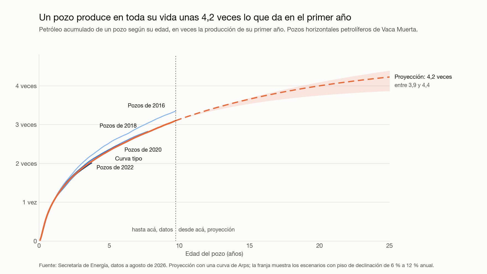

# Bitácora del proyecto

Acá voy anotando el razonamiento a medida que avanzo: qué decidí, por qué, y qué descarté. No es el README (ese cuenta el resultado); esto cuenta el camino.

Trabajé con Claude Code como asistente: lo usé para relevar los portales de datos, perfilar las tablas y escribir los scripts de carga y limpieza. Las preguntas, las decisiones y las consultas de análisis son mías.

---

> Esta es la parte publicada de una bitácora más larga. Por eso la numeración de las secciones y de las preguntas tiene saltos: conservé los números originales.

## 1. De dónde salió la idea

*9 de octubre de 2026*

Quise analizar uno de los temas más candentes hoy en Argentina: la minería y la energía. En San Juan se habla del boom del cobre, y en Neuquén Vaca Muerta ya cambió la balanza energética del país. Además había visto que en Vaca Muerta buscan gente que sepa analizar datos.

No arranqué con una pregunta fija. Arranqué por los datos, porque de proyectos anteriores aprendí que si el dato no existe con el detalle necesario, el análisis termina apoyado en cifras sueltas de informes y declaraciones.

## 2. Screening de datasets

Revisé los portales oficiales de datos abiertos buscando tablas grandes, con detalle fino y actualizadas.

| Tema | Lo que encontré | Conclusión |
|---|---|---|
| Vaca Muerta (Secretaría de Energía) | Producción mes a mes de cada pozo, datos de fractura de cada pozo y un padrón con todos los pozos del país. Actualizado a agosto de 2026. | Granular y al día |
| Minería (SIACAM, Secretaría de Minería) | Empleo por provincia, exportaciones por mineral, cartera de proyectos, anuncios de inversión. | Todo viene ya resumido; no hay producción por mina |
| Electricidad (CAMMESA) | Demanda mensual de cada gran usuario, incluidas algunas mineras. | La serie abierta se corta en febrero de 2020 |

Minería me interesa más por cercanía, pero los datos abiertos no alcanzan para un análisis a nivel operación. Los archivos que cruzaban minería con consumo de energía por proyecto figuran en el catálogo pero dan error al abrirlos.

**Decisión:** Vaca Muerta. Es donde el dato permite contestar preguntas con evidencia y no con supuestos.

## 3. Qué hay adentro del dataset

Son tres tablas que se conectan por el identificador del pozo:

- **Producción:** una fila por pozo y por mes, con petróleo, gas, agua y días que estuvo activo. 426.145 filas de todo el no convencional del país.
- **Fractura:** cómo se construyó cada pozo: largo de la rama horizontal, cantidad de etapas, arena y agua inyectadas, presión. 4.984 filas.
- **Padrón:** los 85.611 pozos del país con empresa, área, coordenadas y fechas de perforación.

Me quedé solo con la formación Vaca Muerta: **3.417 pozos de 48 empresas, 219.848 registros mensuales entre 2006 y agosto de 2026**. Dejé afuera el resto del no convencional (tight gas de otras formaciones) porque son pozos de otro tipo y mezclarlos ensucia las comparaciones.

Unidades, según la fuente: petróleo y agua en metros cúbicos, gas en miles de metros cúbicos.

## 4. La pregunta

Al mirar qué contenía cada tabla, las preguntas salieron solas. El dataset tiene tres cosas de cada pozo: **cómo se diseñó** (fractura), **quién lo opera y dónde está** (padrón) y **cuánto produjo** (producción). Eso permite cruzar decisiones con resultados.

La pregunta que elegí:

> **¿Qué hace que un pozo de Vaca Muerta rinda más: el diseño, la operadora o el lugar?**

La divido en cuatro:

1. ¿Cómo evoluciona la producción de un pozo típico mes a mes, y los pozos nuevos rinden más que los de hace cinco años?
2. ¿Los pozos con rama más larga, más etapas y más arena producen más, o llega un punto donde ya no rinde?
3. ¿Qué operadora saca más por pozo en su primer año, y cuánto mejoró cada una?
4. ¿Cuánto de toda la producción sale de unas pocas áreas y unos pocos pozos?

Para comparar pozos uso la **producción acumulada en los primeros 12 meses**, que pone en igualdad a un pozo de 2018 con uno de 2024.

**Límite que tengo que decir claro:** la pregunta 2 muestra asociación, no causa. Las mejores zonas reciben los pozos más grandes, así que parte del efecto del diseño es efecto del lugar. Para acotarlo voy a comparar pozos dentro de una misma área.

## 5. Herramienta: PostgreSQL

Elegí PostgreSQL porque SQL es lo que más piden los avisos de analista de datos y lo que evalúan en las pruebas técnicas, y hasta ahora no tenía un proyecto propio en SQL. Además el dataset lo pide: son tres tablas relacionadas, no una planilla.

## 6. El modelo de datos

Los CSV repiten en cada fila el nombre de la empresa, el área y la provincia. Los separé en seis tablas donde cada dato vive en un solo lugar:

| Tabla | Una fila es | Filas |
|---|---|---|
| `operadora` | Un grupo empresario | 41 |
| `empresa` | Una razón social que informa producción, con su grupo | 48 |
| `area` | Una concesión | 93 |
| `pozo` | Un pozo | 3.417 |
| `produccion_mensual` | Un pozo en un mes | 219.848 |
| `fractura` | Una operación de fractura de un pozo | 3.090 |

Trabajo en dos capas. La capa `raw` guarda los CSV tal cual vienen, sin tocar. La capa `vm` es el modelo limpio y se reconstruye entera desde `raw` con un script, así cualquier decisión de limpieza queda escrita y se puede rehacer.

## 7. Problemas de calidad y qué decidí

| Problema | Qué era en realidad | Decisión |
|---|---|---|
| La misma empresa con varios nombres (Vista tiene tres) | Cambios de razón social | Tabla `empresa` que agrupa razones sociales por marca. Solo uní las de la misma marca; no seguí compras entre empresas distintas |
| 284 pozos cambiaron de empresa en el tiempo | Ventas de áreas | Guardo la empresa inicial y la actual de cada pozo. Para evaluar a una operadora uso la inicial, que es la que diseñó el pozo |
| Rama horizontal en cero en 458 fracturas | Pozos verticales de la etapa piloto (2013 a 2015), no datos faltantes | Los conservo con una marca `es_horizontal` para poder separarlos |
| 37 pozos con sigla de horizontal y rama en cero | Dato sin cargar | Quedan marcados como sospechosos |
| Pozos repetidos en fractura | Casi todos son de otras formaciones; en Vaca Muerta hay 11 refracturas y unas pocas cargas dobles | Elimino las cargas dobles y numero las fracturas; la número 1 es la original |
| Presiones, volúmenes de agua y de arena imposibles (16 filas) | Errores de carga | No los borro: quedan marcados con el motivo |
| 33 fracturas con fecha de fin anterior a la de inicio | Errores de carga | Marcadas como sospechosas |
| 3 valores negativos de producción | Errores de carga | Pasan a nulo |
| El tipo de pozo cambia con el tiempo (un pozo parado pasa a "Otro tipo") | Así lo informa la fuente | Tomo el tipo más frecuente entre los meses en que produjo |
| 113 pozos de producción no están en el padrón | Todos son de 2026: el padrón publicado es de julio y la producción llega a agosto | Los conservo sin fechas de perforación |

Criterio general: **marcar en vez de borrar.** Así cada análisis decide qué excluir y queda a la vista.

## 8. Controles

Después de limpiar comparé la fuente contra el modelo: cantidad de pozos, filas de producción, petróleo total, gas total, empresas, áreas y pozos con fractura. Los ocho controles coinciden exactamente; no se perdió nada en el camino.

Como chequeo de sentido común: el modelo da 29,1 millones de metros cúbicos de petróleo en 2025, unos 500.000 barriles por día, que es el orden de magnitud que se informa públicamente para Vaca Muerta.

## 9. Pregunta 1: la curva de un pozo y si los nuevos rinden más

*10 de octubre de 2026*

Antes de promediar miré un solo pozo, uno horizontal de YPF en Loma Campana que arrancó en 2019. Ahí se ve la forma: el primer mes produce pocos días, hace pico al tercer o cuarto mes y después cae rápido. También se ve el ruido real: lo pararon en abril y mayo de 2020 por la pandemia.

Para comparar pozos de distintos años no sirve el calendario; sirve la edad. Calculé el **mes de vida** de cada pozo (mes 1 = primer mes con producción).

**Una decisión de método:** la primera versión numeraba las filas de cada pozo. Al revisar encontré 169 pozos con meses sin informar, y numerar filas les corría la edad. Lo cambié por la diferencia entre fechas, que no depende de que estén todas las filas.

**Otra decisión:** para el acumulado del primer año solo cuento pozos que ya cumplieron 12 meses. Si no, estaría comparando un año entero contra uno incompleto. Por eso 2025 incluye solo los pozos que arrancaron hasta septiembre, y 2026 no aparece.

Población: pozos horizontales petrolíferos.

**Lo que encontré:**

| Año de arranque | Pozos | Petróleo en el primer año, mediana (m³) |
|---|---|---|
| 2016 | 67 | 17.323 |
| 2018 | 85 | 27.125 |
| 2020 | 72 | 34.457 |
| 2022 | 201 | 39.545 |
| 2024 | 321 | 35.794 |
| 2025 | 302 | 38.883 |

- **Entre 2016 y 2021 el pozo típico más que duplicó lo que produce en su primer año.**
- **Desde 2021 la mejora se frenó:** la mediana se mueve entre 36.000 y 40.000 m³ sin tendencia clara. Lo que creció desde entonces es la cantidad de pozos, no el rendimiento de cada uno.
- **La forma de la curva no cambió:** todos los años hacen pico al tercer o cuarto mes y al mes 12 producen menos de la mitad que en el pico.
- **La dispersión es grande:** en 2025 el 10 % mejor de los pozos triplica al 10 % peor. Eso es lo que las preguntas 2 y 3 tienen que explicar.

Usé la mediana y no el promedio porque unos pocos pozos excepcionales lo inflan.

## 10. Pregunta 2: el diseño del pozo

*10 de octubre de 2026*

Armé una tabla de trabajo (`pozo_analisis`) con una fila por pozo horizontal petrolífero que ya cumplió 12 meses: su área, su operadora inicial, el petróleo del primer año y el diseño de su fractura original. Son 1.688 pozos; 1.580 tienen el diseño completo y sin datos sospechosos.

**Cómo cambió el pozo típico:**

| Año | Rama (m) | Etapas | Arena (t) | Petróleo 1er año (m³) | Petróleo por km de rama (m³) |
|---|---|---|---|---|---|
| 2016 | 1.411 | 18 | 4.252 | 17.455 | 13.306 |
| 2019 | 2.250 | 33 | 7.931 | 33.511 | 16.846 |
| 2021 | 2.518 | 36 | 8.218 | 38.573 | 16.307 |
| 2023 | 2.684 | 44 | 10.226 | 37.861 | 14.797 |
| 2025 | 3.065 | 50 | 11.761 | 38.533 | 12.695 |

Esto explica el freno que vi en la pregunta 1. Entre 2021 y 2025 los pozos siguieron creciendo: la rama se alargó 22 %, las etapas pasaron de 36 a 50 y la arena subió 43 %. Pero el petróleo del primer año quedó igual. **Cada kilómetro de rama rinde hoy 22 % menos que en 2021.**

Mirando solo los pozos desde 2021, por largo de rama: los de 1.500 a 2.000 metros dan 29.945 m³ en el primer año y los de 3.500 a 4.000 dan 44.337. Más rama da más petróleo por pozo, pero menos por metro (de 16.951 a 12.057 m³ por kilómetro). Son rendimientos decrecientes.

Con la arena pasa algo parecido hasta cierto punto: de 2,5 a 4 toneladas por metro el rendimiento por kilómetro sube, y entre 3,5 y 4,5 se aplana.

**Lo que no puedo afirmar:** que alargar la rama *cause* la caída por kilómetro. Hay al menos dos explicaciones más que los datos no separan: que los pozos nuevos estén en roca menos buena que los primeros, y que las empresas regulen el caudal del primer año por razones operativas o de capacidad de transporte. Lo dejo como asociación.

**Dentro de una misma área** la relación con el diseño cambia mucho: en Loma Campana y Cruz de Lorena los pozos más largos producen claramente más (correlación de 0,61 y 0,65); en Bajada del Palo Oeste no hay relación (−0,05). No hay una receta única.

## 11. Pregunta 3: las operadoras

Tomé como operadora de un pozo a la que lo informaba cuando empezó a producir, porque es la que lo diseñó.

Pozos desde 2021, operadoras con 15 o más:

| Operadora | Pozos | Áreas | Petróleo 1er año, mediana (m³) | Por km de rama (m³) |
|---|---|---|---|---|
| Vista | 166 | 4 | 43.792 | 16.000 |
| Pampa Energía | 19 | 1 | 41.696 | 16.705 |
| YPF | 731 | 13 | 37.184 | 13.909 |
| Kilwer | 35 | 1 | 35.306 | 14.497 |
| Pan American Energy | 86 | 4 | 35.181 | 11.432 |
| Chevron | 31 | 1 | 34.601 | 11.429 |
| Shell | 106 | 3 | 33.713 | 12.629 |
| Tecpetrol | 22 | 2 | 21.467 | 9.355 |

Vista fue primera todos los años entre 2020 y 2024. En 2025 pasó al tercer puesto, detrás de Chevron y Pan American. Tecpetrol aparece última, pero su negocio en Vaca Muerta es el gas (Fortín de Piedra), no el petróleo, así que esta tabla no la representa.

**El hallazgo que cambia cómo leer el ranking:** en Vaca Muerta cada área la opera una sola empresa. De 35 áreas con pozos desde 2021, la única con dos operadoras es Bajo del Choique, y fue un cambio de dueño (de ExxonMobil a Pluspetrol), no dos empresas a la vez. Entonces **no puedo separar a la operadora del lugar**: cuando Vista rinde más que Shell, no sé si es por cómo trabaja o por dónde le tocó perforar.

Lo que sí puedo ver es la misma operadora en distintos lugares. YPF, con el mismo equipo y la misma forma de trabajar, saca 42.477 m³ en Loma Campana y 28.947 en Bajo del Toro Norte. El lugar pesa.

## 12. Pregunta 4: concentración

Acá uso todos los pozos de Vaca Muerta, no solo los horizontales petrolíferos.

- **Cuatro áreas produjeron el 62 % de todo el petróleo** desde 2006: Loma Campana (26 %), La Amarga Chica (15 %), Bandurria Sur (10 %) y Bajada del Palo Oeste (10 %). Son 4 de 93.
- **Esa concentración está bajando:** en los últimos 12 meses las mismas cuatro suman 49 %. Loma Campana pasó de 26 % histórico a 15 %. Entraron áreas nuevas como La Angostura Sur, El Trapial Este y Rincón de Aranda.
- **Por pozo:** el 10 % de los pozos que más produjo aportó el 28 % del petróleo acumulado, y la mitad superior el 85 %. Este número hay que leerlo con cuidado porque un pozo viejo tuvo más tiempo para acumular que uno nuevo.
- **Por operadora:** YPF informa el 52 % del petróleo de los últimos 12 meses.

## 13. La respuesta: ¿diseño, operadora o lugar?

Medí qué parte de las diferencias de producción entre pozos acompaña a cada factor, en los 1.143 pozos desde 2021 con diseño confiable:

| Factor | Parte de las diferencias que explica |
|---|---|
| El lugar (área) | 18 % |
| La operadora | 10 % |
| El año de arranque | 1 % |
| La arena inyectada | 20 % |
| La cantidad de etapas | 22 % |
| El largo de la rama | 15 % |

Los porcentajes no se suman entre sí: la operadora está contenida en el lugar (cada área tiene una sola), y las tres medidas de diseño se mueven juntas.

Para combinar lugar y diseño le resté a cada pozo el promedio de su área y volví a medir. Dentro de una misma área, la arena explica otro 20 % de lo que queda. **Sumando lugar y diseño se llega a un 35 % aproximadamente.**

**Mi conclusión:**

1. **Ningún factor domina.** El lugar y el diseño pesan parecido, alrededor de un quinto cada uno.
2. **La operadora no se puede aislar** con estos datos, porque viene pegada al lugar.
3. **Casi dos tercios de las diferencias entre pozos no los explica nada de lo que publica la Secretaría.** Ahí está la geología fina de cada pozo y decisiones operativas que no figuran en los datos abiertos.
4. **Lo más firme que encontré** es que desde 2021 los pozos son cada vez más grandes sin rendir más: cada kilómetro de rama produce 22 % menos.

Dentro de una misma área, cada metro extra de rama se asocia con 9,7 m³ más de petróleo en el primer año, y cada tonelada extra de arena con 2,4 m³ más.

## 14. El tablero

*10 de octubre de 2026*

Quería hacerlo en Power BI porque es lo que más piden los avisos y nunca lo usé, pero Power BI Desktop solo existe para Windows y mi Mac no tiene memoria ni disco para correr una máquina virtual. Lo hago en Tableau Public, que ya conozco, y dejo Power BI para el próximo proyecto.

Exporté tres tablas desde la base para alimentar el tablero: una fila por pozo, la producción por mes de vida y la producción mensual por área. Armé también una imagen con los cuatro hallazgos para tener una referencia de cómo tienen que verse los gráficos.

Una decisión de diseño: para mostrar que los pozos crecen pero no rinden más, puse las cuatro medidas (arena, rama, petróleo del primer año, petróleo por kilómetro) como índice con 2021 = 100. Así se comparan en una misma escala sin usar dos ejes, que confunden.

## 15. Una capa más: por qué pasa lo que encontré

*10 de octubre de 2026*

Los datos me dijeron qué pasó. Para el porqué busqué qué dicen consultoras, trabajos técnicos y prensa especializada, y después volví a los datos para poner a prueba cada explicación. Las consultas están en `sql/analisis/p6_por_que_cae_el_rendimiento.sql`.

### Lo que confirman otras fuentes

**La mejora hasta 2020 está documentada y coincide con mis números.** La consultora FDC armó un "pozo tipo" por año (nota de LM Neuquén, enero de 2021):

| Año | Rama según FDC (m) | Rama en mis datos (m) | Acumulada a 365 días según FDC (m³) | Mediana en mis datos (m³) |
|---|---|---|---|---|
| 2016 | 1.350 | 1.411 | 17.000 | 17.323 |
| 2018 | 2.030 | 2.000 | 27.800 | 27.125 |
| 2019 | 2.115 | 2.250 | 37.000 | 33.270 |
| 2020 | 2.215 | 2.207 | 41.500 | 34.457 |

Que dos caminos independientes den casi lo mismo es la mejor validación que tengo del modelo. La diferencia en 2019 y 2020 puede venir de que FDC usa un pozo tipo y yo la mediana de todos los pozos. La misma fuente muestra que el costo por pozo bajó de 16,5 a 9,5 millones de dólares entre 2016 y 2020: los pozos mejoraban y además salían más baratos.

**La caída por metro desde 2021 también la vio otro.** Un análisis de la consultora Enverus habla de una baja anual de 7 a 12 % en la productividad por pie de rama desde 2021, y la atribuye a que las operadoras se expanden a zonas menos productivas y a cambios en el espaciamiento entre pozos. Mi número es más moderado: 22 % en cuatro años, unos 6 % anual. No pude abrir la nota original (el sitio bloquea el acceso), así que la tomo del resumen del buscador y no sé de qué fecha es.

**La interferencia entre pozos vecinos está estudiada en Vaca Muerta.** Un trabajo presentado en el congreso del IAPG en 2022 analizó 107 pozos "padres" y 80 "hijos" en Loma Campana: cuando se fractura un pozo nuevo al lado de uno que ya produce, las fracturas se comunican y el pozo nuevo puede rendir menos.

**El transporte estuvo al límite.** La ampliación del oleoducto de Oldelval se inauguró en marzo de 2025 y a mediados de 2026 el sistema volvía a estar cerca de su tope.

### Las explicaciones, puestas a prueba

**1. "Se perfora en zonas menos buenas." Es cierto solo en parte.**

Llamo áreas históricas a las cuatro que concentran la producción. En 2021 recibían el 76 % de los pozos nuevos; en 2025, el 47 %. Y fuera de ellas el rendimiento por kilómetro es menor. Hasta ahí coincide.

Pero al separar los dos grupos aparece otra cosa:

| Año | Áreas históricas (m³ por km) | Resto (m³ por km) |
|---|---|---|
| 2021 | 17.211 | 12.629 |
| 2023 | 15.526 | 12.460 |
| 2025 | 13.212 | 12.045 |

**La caída está dentro de las áreas históricas** (23 % menos), mientras el resto casi no se movió. En 2025 las mejores zonas rinden por kilómetro apenas un 10 % más que las nuevas. Área por área: Bajada del Palo Oeste pasó de 20.379 a 14.361 y Loma Campana de 18.136 a 14.083. Entonces el problema no es solo irse a zonas peores: las zonas buenas ya no rinden como antes.

**2. "Los pozos nuevos compiten con los vecinos." No lo pude confirmar.**

Conté, para cada pozo, cuántos pozos al menos un año más viejos tiene a menos de 1,5 km. Si la interferencia fuera fuerte, los pozos rodeados deberían rendir menos. No pasa: los que no tienen vecinos dan 13.503 m³ por km y los que tienen 16 o más dan 15.604. Solo en Bajada del Palo Oeste se ve el efecto esperado (19.536 contra 15.041).

Mi medición es tosca: uso la ubicación de la boca del pozo, no por dónde va la rama bajo tierra, y los pozos rodeados suelen estar en la mejor roca. No descarta la interferencia; dice que con este dato no se ve.

**3. "Doce meses es poco para juzgar un pozo largo." No.**

Repetí la cuenta a 24 meses: el rendimiento por kilómetro cae igual, de 25.094 (pozos de 2019) a 19.591 (pozos de 2024). Y los pozos largos no declinan más lento: el segundo año rinde la mitad del primero, sea cual sea el largo.

**4. Un dato que no esperaba: el mejor mes de un pozo no crece.**

El mes de mayor producción de un pozo típico está clavado entre 5.600 y 5.800 m³ desde 2021, aunque la rama creció 16 %. Es lo que se esperaría si las empresas limitaran el caudal inicial (por cuidado del pozo o por capacidad de las instalaciones), pero también si simplemente el tramo extra de rama aporta poco. Los datos no distinguen entre las dos.

### Lo que me queda

- **Confirmado:** la mejora hasta 2020 y la caída por kilómetro desde 2021 son reales y otros las vieron.
- **Parcialmente explicado:** irse a zonas nuevas explica una parte menor. La mayor parte de la caída ocurre en las áreas históricas.
- **Descartado:** que sea un efecto de mirar solo 12 meses.
- **Abierto:** por qué las áreas históricas rinden menos por kilómetro. Las candidatas son la interferencia entre vecinos, que mi dato no alcanza a medir, y el límite de caudal.

**Cómo seguiría:** la Secretaría publica las trayectorias de los pozos de Vaca Muerta (el recorrido de cada rama). Con eso se puede medir la distancia real entre ramas vecinas y probar bien la interferencia.

### Fuentes

- LM Neuquén (16 de enero de 2021), "La evolución de los pozos que hizo rentable Vaca Muerta", con datos de FDC: https://mase.lmneuquen.com/pozos/la-evolucion-los-pozos-que-hizo-rentable-vaca-muerta-n764268
- Mamani, Rosemblat y Álvarez Castillo (2022), "Evaluación de frac-hits y su impacto en Loma Campana", IAPG: https://biblioteca.iapg.org.ar/bib/195890
- Enverus, "Vaca Muerta: the global shale game changer" (no pude abrirla; cito el resumen del buscador): https://www.enverus.com/blog/vaca-muerta-the-global-shale-game-changer/
- EconoJournal, sobre la capacidad de Oldelval: https://econojournal.com.ar/?p=131806

## 16. Segundo screening: qué más se puede preguntar

*10 de octubre de 2026*

Con el primer análisis cerrado busqué dos cosas: de qué se está hablando hoy en Vaca Muerta, y qué otros datos publica la Secretaría para sumar al modelo.

**Los temas del momento** (prensa especializada, octubre de 2026):

- **Sacar el petróleo:** el oleoducto de Oldelval está al límite y el nuevo, Vaca Muerta Oil Sur, entra en operación en 2027.
- **La logística de la fractura:** en junio de 2026 quedaron más de mil etapas sin hacer, no por falta de equipos sino por descoordinación; se bombean más de 600 mil toneladas de arena por mes.
- **Los costos:** YPF sostiene que un pozo cuesta 30 % más que en Estados Unidos; el punto de equilibrio que se cita ronda los 45 dólares por barril.
- **El gas:** sobra en verano y falta mercado; los proyectos de exportación de gas licuado arrancan a fines de 2027.
- **Inversiones nuevas:** proyectos grandes entrando al régimen de incentivos (RIGI) y áreas nuevas en desarrollo.

**Datos que encontré para sumar:**

| Dataset | Filas | Qué permite |
|---|---|---|
| Trayectorias de pozos de Vaca Muerta | 2.363 pozos | El recorrido real de cada rama y en qué nivel de la roca navega |
| Inversiones upstream (Res. 2057) | 45.422 | Millones de dólares invertidos por mes, área y empresa |
| Volúmenes transportados por ducto | 57.946 | Cuánto pasa por cada oleoducto y gasoducto, por mes |
| Perforación (pozos terminados, metros) | 488.416 | Actividad de perforación por empresa y área |
| Precios del gas natural | 1.602 | Precio por cuenca y tipo de contrato, incluida exportación |

**Lo que ya se ve con los datos que tengo cargados**, sin bajar nada:

- La velocidad de fractura se duplicó: de 0,9 etapas por día en 2017 a 2,2 en 2026.
- La arena importada pasó del 15 % en 2017 a cero desde 2022.
- La espera entre terminar la fractura y empezar a producir bajó de 38 días a 12.
- Los pozos de gas trabajan 22 días por mes en julio y agosto, y 16 o 17 entre octubre y diciembre. En diciembre el 23 % no produce nada.

## 17. Pregunta 7: lo que pasa bajo tierra

*10 de octubre de 2026*

Me había quedado abierta la interferencia entre pozos vecinos, porque solo tenía la ubicación de las bocas. Sumé el dataset de trayectorias: el recorrido de cada rama y el nivel de la roca en el que navega.

**Qué tuve que resolver para usarlo:**

- **Los códigos del nivel no venían explicados.** Los encontré en una tabla del instructivo oficial de la Secretaría: la formación se divide en seis unidades numeradas desde abajo. U1 es Vaca Muerta Inferior y U2 y U3 son Vaca Muerta Medio. El 96 % de los pozos navega en U1 o U2.
- **460 filas no tenían código de pozo.** Las enlacé por la sigla.
- **La fuente da el recorrido completo desde la superficie, sin profundidad.** Para quedarme con la rama recorrí cada trazado desde el fondo hacia atrás hasta completar el largo de rama informado, y dejé un punto cada 50 metros. Como control, el largo que sale así coincide con el de la tabla de fracturas (diferencia mediana de cero metros).
- **Medir distancias entre 75.000 puntos.** La primera versión comparaba todos contra todos y no terminaba. La rehíce dividiendo el mapa en celdas de 1.500 metros y comparando cada punto solo con los de su celda y las ocho de alrededor. Tarda dos minutos.
- **Dos ramas apiladas a distinta profundidad parecen pegadas vistas desde arriba.** Por eso mido la distancia solo contra ramas del mismo nivel.

**Un límite:** la cobertura es de más del 90 % hasta 2023, pero cae a 44 % en 2024 y 25 % en 2025. Las conclusiones valen sobre todo para 2019 a 2023.

**Lo que encontré:**

**1. El nivel importa, y mucho.** En el mismo lugar, los pozos que navegan en U1 rinden más por kilómetro que los de U2:

| Área | U1 (m³ por km) | U2 (m³ por km) | Diferencia |
|---|---|---|---|
| Loma Campana | 18.136 | 12.313 | +47 % |
| La Amarga Chica | 17.080 | 14.033 | +22 % |
| Bajada del Palo Oeste | 19.408 | 16.672 | +16 % |
| Bandurria Sur | 15.526 | 14.062 | +10 % |

**2. La interferencia entre vecinos aparece ahora que mido bien.** En las áreas históricas, según la distancia al pozo padre más cercano del mismo nivel:

| Distancia al padre | U1 (m³ por km) | U2 (m³ por km) |
|---|---|---|
| Menos de 300 m | 15.526 | 12.710 |
| De 300 a 500 m | 17.197 | 13.066 |
| De 500 a 1.500 m | 18.476 | 14.749 |

Un pozo con un padre a menos de 300 metros rinde alrededor de 15 % menos que uno que lo tiene a más de 500. El escalón se repite en los dos niveles. Con las bocas de pozo esto no se veía; con las ramas sí. Los grupos más cercanos son chicos (23 y 60 pozos), así que el tamaño exacto del efecto es incierto.

**3. Cada vez más pozos nacen al lado de un padre.** En 2019 el 18 % de los pozos nuevos de las áreas históricas tenía un padre del mismo nivel a menos de 500 metros; entre 2021 y 2023, cerca del 40 %. El espaciamiento entre ramas vecinas, en cambio, casi no cambió: unos 290 metros.

**4. Nada de esto alcanza para explicar la caída.** Mirando un solo nivel dentro de las áreas históricas, el rendimiento igual baja: en U1, de 18.885 m³ por km en 2021 a 15.367 en 2024. Y cada vez más pozos van a U1, el nivel bueno, lo que debería empujar para arriba. La interferencia suma, pero afecta a una parte de los pozos y en un 15 %.

**Cómo queda la cuenta de qué pesa más** (pozos desde 2021):

| Se tiene en cuenta | Parte de las diferencias que explica |
|---|---|
| Solo el lugar | 18 % |
| Lugar y nivel | 26 % |
| Lugar, nivel y arena | cerca de 39 % |

Sumar el nivel de navegación me lleva de 35 % a 39 %. Sigue quedando un 60 % sin explicar.

**Mi lectura:** el lugar en el mapa no alcanzaba porque faltaba la tercera dimensión. Dentro de una misma área hay roca mejor y peor según la profundidad, y eso se ve en los datos. La caída del rendimiento por kilómetro sigue sin una causa única: irse a zonas nuevas explica un poco, la interferencia otro poco, y el resto queda abierto.

## 18. Pregunta 8: la fábrica de pozos

*10 de octubre de 2026*

En el sector se habla de Vaca Muerta como una fábrica: perforar, fracturar y conectar pozos en serie. El tema del momento es la logística, así que medí cuánto creció y cuánto se aceleró esa fábrica con la tabla de fracturas.

**Creció siete veces en ocho años:**

| Año | Etapas de fractura | Arena (miles de t) | Agua (millones de m³) | Arena importada |
|---|---|---|---|---|
| 2017 | 3.244 | 665 | 4,2 | 15 % |
| 2021 | 8.738 | 2.025 | 12,8 | 1 % |
| 2025 | 23.410 | 5.337 | 35,3 | 0 % |

- **La arena dejó de importarse.** En 2015 venía de afuera el 76 %; desde 2022, nada.
- **Fracturar es más del doble de rápido:** de 0,9 etapas por día en 2017 a 2,2 en 2026.
- **Pero fracturar un pozo lleva lo mismo que antes, unos 25 días,** porque cada pozo tiene más del doble de etapas (22 en 2017, 51 en 2026). Toda la velocidad ganada se usó en hacer pozos más grandes.

**El ciclo completo no se acortó.** Desde que se empieza a perforar hasta que el pozo produce pasan unos 213 días, casi lo mismo que en 2017 (212). En el medio hay una espera de unos 70 días entre terminar de perforar y empezar a fracturar que no baja desde 2018. Lo único que mejoró es el tramo final: de la fractura al pozo terminado se pasó de 21 a 12 días.

Esto coincide con lo que dice el sector: el límite ya no son los equipos sino la coordinación entre etapas.

**Por operadora** (pozos fracturados desde 2024): Vista (2,3 etapas por día), Pan American (2,2) e YPF (2,1) son las más rápidas. Pluspetrol es la más lenta (1,0): tarda 48 días por pozo contra 22 de Vista.

**Cuidados:**
- La fuente tiene unos tres meses de demora. Julio de 2026 figura con 174 etapas contra unas 1.600 de los meses anteriores, así que 2026 está incompleto.
- Encontré tres fracturas con fecha de inicio posterior a la descarga. Agregué una regla de limpieza que las marca como sospechosas.
- Las fechas de perforación parecen corresponder a la campaña del grupo de pozos y no a cada pozo, así que no informo cuánto se tarda en perforar uno.

## 19. Pregunta 9: el gas y las estaciones

Hasta acá todo fue petróleo. El gas es una cuarta parte de los pozos horizontales y es el otro gran tema: sobra en verano y los proyectos para exportarlo recién arrancan a fines de 2027.

**La producción de los pozos de gas sigue al invierno, y cada año más:**

| Año | Pico de julio y agosto (MMm³/día) | Valle de octubre y noviembre | Caída |
|---|---|---|---|
| 2022 | 49,1 | 42,3 | 14 % |
| 2023 | 59,3 | 49,9 | 16 % |
| 2024 | 73,9 | 53,3 | 28 % |
| 2025 | 78,1 | 49,7 | 36 % |

En primavera los pozos de gas trabajan 17 días por mes contra 24 en invierno, y uno de cada cinco no produce nada. No es que rindan menos: los cierran porque no hay a quién venderle.

**El que absorbe el golpe es Fortín de Piedra,** el área de Tecpetrol: pasa de 20,0 a 11,6 millones de m³ por día, una caída de 42 %. Aguada Pichana Este y La Calera casi no varían (10 y 11 %).

**Los pozos de gas se programan para el invierno.** El 56 % de los pozos gasíferos nuevos arranca entre febrero y junio. Los petrolíferos se reparten parejo todo el año.

**Lo que no esperaba: el gas que viene con el petróleo.** Los pozos petrolíferos también producen gas, y ese gas no se puede cerrar sin cerrar el petróleo. Pasó de 7,9 millones de m³ por día en enero de 2024 a 18,1 en agosto de 2026: más del doble en dos años y medio. En cambio, el pico de los pozos de gas casi no creció entre 2025 y 2026 (79,1 contra 80,4).

Es decir: cada vez hay más gas que sale sí o sí, todo el año, y que en primavera le saca lugar al de los pozos gasíferos. Eso ayuda a entender por qué la caída estacional se agranda, y por qué la exportación de gas licuado es tan esperada.

**Cuidado:** que el gas asociado desplace al otro es mi lectura de los dos datos juntos; los datos de producción no muestran quién le vende a quién.

## 20. Segunda vuelta de explicaciones

*10 de octubre de 2026*

Antes de seguir dejé marcada la versión presentable del proyecto (etiqueta `v1.0` en el repositorio). Lo que sigue es una segunda parte.

Repetí el ciclo: buscar qué dice el sector sobre lo que encontré en las preguntas 7, 8 y 9.

**Sobre el gas (pregunta 9).** Una nota de LM Neuquén titulada "El boom del petróleo de Vaca Muerta arrincona al gas seco" describe lo mismo que yo había leído en los datos: el gas asociado fluye sin parar y choca contra un consumo que cae en verano. Cita que en el verano de 2025 los cierres de pozos sacaron 29 millones de m³ por día del sistema; mi caída entre pico y valle de ese año es de 28. Sobre Fortín de Piedra, otra nota habla de un récord de 24 millones de m³ diarios en invierno y unos 13 en verano; mis promedios dan 20,0 y 11,6.

**Sobre la espera entre perforar y fracturar (pregunta 8).** En el sector a esos pozos se los llama DUC: perforados y sin completar. Según las notas, en 2023 algunas petroleras dejaron de perforar porque no daban abasto para fracturar lo ya perforado, y hoy el riesgo es el contrario: que falten pozos listos para que los equipos de fractura no queden parados. Un inventario de pozos en espera es parte de cómo funciona la fábrica, lo que explica que mis 70 días no bajen.

**Sobre la cantidad de etapas.** El relevamiento privado del sector (NCS Multistage) cuenta 12.198 etapas entre enero y mayo de 2026; mis datos tienen 10.126 para esos meses, el 83 %. Para junio da 2.760 contra mis 1.589. Confirma que la fuente oficial llega con demora y que los últimos meses están muy incompletos.

**Sobre la arena.** Al principio se importaba, incluso cerámica. Después se desarrollaron canteras en Chubut y Entre Ríos, y desde 2021 arena "de cercanía" de Río Negro, más barata por el flete (el transporte es más del 65 % del costo de la arena puesta en el pozo). Coincide con mi serie: 76 % importada en 2015, cero desde 2022.

**Sobre el espaciamiento y los vecinos (pregunta 7).** Tecpetrol fijó una regla de 225 metros entre pozos en Fortín de Piedra. Y un directivo de la consultora Rystad señala al distanciamiento y al efecto padre-hijo como fuentes de pérdidas importantes, en una nota titulada "perforar más no siempre significa producir más".

No encontré una fuente que compare el rendimiento por nivel de navegación; ese resultado queda sin contraste externo.

## 21. Pregunta 10: ¿alcanza el oleoducto?

El tema más repetido es que el petróleo no tiene por dónde salir. Sumé los volúmenes que declara cada oleoducto y me quedé con el troncal Allen - Puerto Rosales de Oldelval, la salida principal hacia el Atlántico.

| Año | Producción de Vaca Muerta (miles de barriles por día) | Oleoducto troncal |
|---|---|---|
| 2021 | 162 | 202 |
| 2022 | 243 | 251 |
| 2023 | 306 | 276 |
| 2024 | 387 | 294 |
| 2025 | 501 | 403 |
| 2026 | 622 | 507 |

- **En 2022 Vaca Muerta sola ya producía casi todo lo que llevaba el troncal.**
- **Durante 2024 el caño estuvo lleno.** Transportó entre 285 y 310 mil barriles por día los doce meses, sin moverse, mientras la producción creció 26 %. La diferencia salió por otros lados: refinerías de la zona y el oleoducto a Chile.
- **El caño nuevo (Duplicar) arranca en marzo de 2025** y se ve en el dato: el total pasa de 333 a 542 mil barriles por día en agosto de 2026.
- **Ya está otra vez en el techo.** La prensa cita 530 mil barriles por día como límite del sistema; agosto de 2026 dio 542.

Los datos confirman, con números oficiales, lo que se discute: la infraestructura se llena apenas se inaugura. El próximo oleoducto está previsto para 2027.

**Cuidado:** por el troncal pasa también petróleo convencional, y Vaca Muerta tiene otras salidas, así que las dos columnas no son comparables una a una. Lo que sí muestran es el momento en que el caño deja de crecer.

## 22. Pregunta 11: el precio del gas

Para completar la pregunta 9 sumé el precio del gas de la cuenca Neuquina.

| Año | Precio en invierno (USD por millón de BTU) | Precio en primavera | Caída del precio | Caída del volumen |
|---|---|---|---|---|
| 2022 | 3,32 | 2,62 | 21 % | 14 % |
| 2023 | 3,23 | 1,97 | 39 % | 16 % |
| 2024 | 3,52 | 2,49 | 29 % | 28 % |
| 2025 | 3,46 | 2,45 | 29 % | 36 % |

El precio cae todas las primaveras entre 20 % y 40 %, pero esa caída no se agrandó. Lo que se agrandó es la caída del volumen. Mi lectura: ya no alcanza con bajar el precio para colocar el gas; directamente no hay quién lo compre, y por eso se cierran pozos.

El precio del gas exportado en primavera también bajó: de 7,67 dólares en 2022 a 3,88 en 2025.

## 23. Pregunta 12: cuánto cuesta un pozo

Crucé las inversiones en perforación que declaran las empresas con los pozos que empezaron a producir.

| Año | Inversión en perforación (millones de USD) | Pozos conectados | Millones de USD por pozo |
|---|---|---|---|
| 2019 | 1.753 | 182 | 9,6 |
| 2021 | 2.468 | 258 | 9,6 |
| 2023 | 4.942 | 329 | 15,0 |
| 2024 | 5.753 | 406 | 14,2 |
| 2025 | 5.755 | 467 | 12,3 |

**Validación:** la consultora FDC estimaba 10,5 millones por pozo en 2019 y 9,5 en 2020. Mis números para esos años dan 9,6 y 9,1.

**El pozo se encareció más de 50 % entre 2021 y 2023** (de 9,6 a 15,0 millones) y después bajó algo. Es consistente con pozos más largos y con más arena, y con el reclamo de YPF de que los servicios cuestan 30 % más que en Estados Unidos.

**Uniendo costo y producción** en las cuatro áreas históricas: dólares de perforación por cada barril que el pozo da en su primer año.

| Año | Millones de USD por pozo | Dólares por barril del primer año |
|---|---|---|
| 2021 | 8,8 | 34 |
| 2023 | 14,8 | 59 |
| 2025 | 14,2 | 57 |

Este número junta los dos hallazgos del proyecto: el pozo cuesta más y no produce más, así que cada barril del primer año sale casi 70 % más caro que en 2021. No es el costo total del barril: un pozo produce varias veces más a lo largo de su vida que en el primer año.

**Límites, que acá son importantes:**

- **Son declaraciones juradas sin auditar.** Tres áreas de Shell y una de YPF dan entre 4 y 8 millones por pozo, que no es creíble: seguramente cargan parte de la perforación bajo otro concepto. Por eso el análisis fino lo hice solo en las cuatro áreas históricas, donde los números son coherentes entre sí.
- **Son dólares corrientes,** sin ajustar por inflación.
- **La plata se gasta meses antes de que el pozo produzca.** Comparar inversión y pozos del mismo año es una aproximación.

## 24. Pregunta 13: el gas, a fondo

*10 de octubre de 2026*

Todo el análisis de rendimiento (preguntas 1 a 7) lo había hecho con pozos petrolíferos. Una cuarta parte de los pozos horizontales es de gas y había quedado afuera. Lo repetí para esos 670 pozos.

**Tuve que cambiar la medida.** Con el petróleo usé lo que el pozo acumula en 12 meses. Con el gas eso no sirve: como vi en la pregunta 9, a los pozos de gas los cierran parte del año por falta de demanda, así que lo acumulado depende de cuánto los dejaron producir y no de lo bueno que es el pozo. Uso el **caudal**: el gas del primer año dividido por los días que el pozo estuvo activo, en miles de m³ por día. En su primer año un pozo de gas típico trabaja unos 320 días de 365.

**La historia se parece a la del petróleo, con un final distinto:**

| Año | Pozos | Caudal (miles de m³ por día) | Rama (m) | Arena (t) | Caudal por km |
|---|---|---|---|---|---|
| 2017 | 39 | 163 | 1.639 | 4.578 | 87 |
| 2021 | 84 | 299 | 2.500 | 7.562 | 116 |
| 2023 | 90 | 329 | 2.768 | 9.785 | 119 |
| 2025 | 59 | 281 | 2.802 | 10.776 | 109 |

- **Mejoró fuerte hasta 2021** y se estabilizó, igual que el petróleo.
- **El rendimiento por kilómetro casi no cayó** (de 116 a 109, un 6 %). En petróleo cayó 22 %.
- **La rama dejó de crecer:** 2.768 metros en 2023 y 2.802 en 2025. En petróleo siguió creciendo hasta pasar los 3.000.
- **Se perforan los mismos pozos de gas todos los años:** entre 81 y 90 por año de 2021 a 2024. Los de petróleo pasaron de 174 a 321. El gas no crece porque no tiene a quién venderle, no porque la roca no dé.

**Por área** (cada una con su única operadora): Sierra Chata, de Pampa Energía, es la mejor con 448 mil m³ por día; siguen Aguada Pichana Oeste (380) y Fortín de Piedra (358). La Calera, de Pluspetrol, es la más baja (221) y tiene las ramas más largas.

**Las tres diferencias con el petróleo:**

| | Petróleo | Gas |
|---|---|---|
| Parte de las diferencias que explica el lugar | 18 % | 42 % |
| Ventaja de navegar en U1 sobre U2 | de 10 % a 47 % | ninguna |
| Caída del rendimiento por km desde 2021 | 22 % | 6 % |

- **En gas el lugar pesa más del doble.** Saber en qué área está un pozo de gas dice mucho más sobre cuánto va a rendir. Sumando la arena se llega a 48 % explicado, contra 39 % en petróleo.
- **El nivel de navegación no importa.** En las seis áreas donde pude comparar, U1 y U2 rinden prácticamente lo mismo. En petróleo era una de las diferencias más marcadas.
- **La interferencia sí aparece también en gas:** con un pozo padre del mismo nivel a menos de 500 metros el caudal por kilómetro es 95, contra 118 cuando está más lejos, cerca de 20 % menos.

**Mi lectura:** la caída del rendimiento por kilómetro que encontré en petróleo no es una ley de Vaca Muerta. En gas, donde la actividad no se aceleró y las ramas dejaron de alargarse, el rendimiento se mantuvo. Eso apunta a que la caída del petróleo tiene que ver con cómo se está desarrollando (pozos cada vez más largos, más cerca unos de otros, en áreas ya muy perforadas) más que con un agotamiento de la roca. Es una comparación sugerente, no una prueba: son zonas distintas de la formación.

**Un dato para seguir:** en 2026 ya arrancaron 88 pozos de gas hasta agosto, más que en cualquier año completo anterior.

## 25. Pregunta 14: a dónde va el petróleo

*10 de octubre de 2026*

Sumé dos fuentes: lo que se embarca en la terminal de Puerto Rosales y lo que cruza a Chile por el Oleoducto Trasandino.

| Año | Por barco | Por oleoducto a Chile | Producción de Vaca Muerta | Se exporta |
|---|---|---|---|---|
| 2020 | 19 | 0 | 113 | 16 % |
| 2022 | 73 | 0 | 243 | 30 % |
| 2024 | 82 | 71 | 387 | 40 % |
| 2025 | 161 | 80 | 502 | 48 % |
| 2026 (enero a julio) | 249 | 75 | 615 | 53 % |

*Miles de barriles por día.*

- **Más de la mitad del petróleo de Vaca Muerta ya se exporta.** En 2020 era el 16 %.
- **Los barcos se triplicaron en dos años:** de 82 mil barriles por día en 2024 a 249 mil en 2026. Coincide con el caño nuevo de la pregunta 10: entre 2022 y 2024 la exportación por barco estuvo clavada en unos 80 mil porque no había cómo llevar más petróleo hasta el puerto.
- **Mientras el caño estuvo lleno, la salida fue Chile.** El oleoducto trasandino se reabrió en 2023 y en 2024 ya llevaba casi tanto como los barcos.

**Los destinos se están abriendo:**

| Destino | 2022 | 2025 | 2026 |
|---|---|---|---|
| Estados Unidos | 67 % | 52 % | 35 % |
| Chile | 3 % | 33 % | 23 % |
| Tailandia, Australia, China, Malasia, Singapur y Vietnam | 0 % | 5 % | 28 % |
| Brasil | 19 % | 3 % | 3 % |

En 2026 aparece Asia y Oceanía: en siete meses pasó de casi nada a más de un cuarto de lo exportado.

**Quién exporta** (desde 2025): Vista es la primera con 21 % sumando sus dos sociedades; siguen YPF (12,5 %), Shell (10,7 %) y la sociedad de YPF con Chevron (9,5 %). YPF produce más de la mitad del petróleo pero exporta mucho menos, porque abastece sus propias refinerías.

**Cuidado:** lo embarcado es petróleo de toda la cuenca Neuquina, no solo de Vaca Muerta, así que el porcentaje sobre la producción es aproximado.

## 26. Pregunta 15: cuánto queda

Las reservas se publican en un Excel por año, con formato de planilla para leer y no para procesar. Escribí un script que abre los nueve archivos (2017 a 2025), ubica el bloque de recursos no convencionales y los deja en una sola tabla.

Uso las **reservas comprobadas**: lo que se puede producir con certeza razonable, con la tecnología y los precios de hoy.

| Año | Petróleo comprobado (millones de m³) | Producido en el año | Años que alcanza | Sumado por cada m³ producido |
|---|---|---|---|---|
| 2017 | 19,4 | 2,2 | 8,9 | |
| 2019 | 108,5 | 5,2 | 20,8 | 10,1 |
| 2021 | 175,9 | 9,4 | 18,6 | 7,2 |
| 2023 | 245,8 | 17,7 | 13,9 | 2,5 |
| 2025 | 414,5 | 29,1 | 14,2 | 5,2 |

- **Las reservas de petróleo se multiplicaron por 21 en ocho años.**
- **Se repone mucho más de lo que se saca:** en 2025, por cada metro cúbico producido se sumaron 5,2 de reservas nuevas.
- **Aun así alcanzan para menos años que antes,** unos 14 contra casi 21 en 2019, porque la producción creció todavía más rápido.
- **En gas** hay 457 mil millones de m³ comprobados, unos 17 años al ritmo actual, y esa cifra casi no se mueve desde 2019. Coincide con lo que vi en las preguntas 9 y 13: el gas está, lo que falta es mercado.

**Por área,** las cuatro históricas tienen el 49 % de las reservas de petróleo y el 54 % de la producción. Pero no evolucionan igual:

| Área | Comprobado en 2021 | Comprobado en 2025 | Años al ritmo actual |
|---|---|---|---|
| Loma Campana | 48,8 | 57,0 | 11 |
| La Amarga Chica | 30,2 | 55,7 | 13 |
| Bandurria Sur | 18,3 | 51,7 | 15 |
| Bajada del Palo Oeste | 20,4 | 39,0 | 13 |

Loma Campana, la más vieja, casi no sumó reservas en cuatro años (17 % más) mientras las otras tres las duplicaron o triplicaron. Es el área con menos años por delante. Encaja con lo que encontré en la pregunta 6: es donde más cayó el rendimiento por kilómetro.

Detrás de las comprobadas hay mucho más: los recursos que todavía no son comerciales pasaron de 79 a 1.337 millones de m³ entre 2020 y 2025.

**Cuidados:** las reservas son estimaciones que declaran las propias empresas. Y cubren todo lo no convencional de cada área, mientras que mi producción es solo de la formación Vaca Muerta; en petróleo es casi lo mismo, en gas la diferencia puede ser mayor.

## 31. Revisión de la ingeniería

*10 de octubre de 2026*

Después de sumar ocho datasets me pregunté si los estaba manejando bien. Hice un inventario.

**Lo que está bien:**

- **Dos capas.** `raw` guarda cada archivo tal cual llega (14 tablas) y `vm` es el modelo limpio (16 tablas y 5 vistas). Nunca edito un dato a mano: toda corrección está escrita en un script.
- **Se reconstruye entero.** Un script rearma la base desde los archivos en unos cinco minutos. Lo probé varias veces.
- **El núcleo está bien atado.** Las seis tablas centrales y las de trayectorias tienen claves que la base hace cumplir.
- **Controles contra la fuente** para el núcleo.

**Lo que estaba flojo, y arreglé:**

- **No había registro de qué bajé ni cuándo.** Las fuentes cambian todos los meses y los archivos originales no van al repositorio por su tamaño. Agregué un script que anota, para cada archivo, organismo, fecha de descarga, tamaño, filas y una huella que cambia si cambia el contenido.
- **Las tablas nuevas no tenían controles.** Agregué diez: que los enlaces por nombre de área sigan enganchando más del 95 %, que no falten meses, que la exportación no supere a la producción, que la tasa de regalías esté en un rango creíble. Dan todos bien.
- **No estaba escrito cómo se une cada tabla.** Lo agregué al diccionario.

**Lo que sigue flojo, y lo dejo anotado:**

- **Dos tablas se unen por el nombre del área,** que es texto. Hoy engancha el 98 y el 99 %, pero si la fuente cambia cómo escribe un nombre, se pierde sin aviso. El control nuevo lo detectaría.
- **Los nombres de empresa de inversiones y exportaciones no están unidos a las operadoras.** Por eso no puedo cruzar, por ejemplo, cuánto exporta cada operadora contra cuánto produce, sin emparejar nombres a mano.
- **Varias tablas solo comparten el mes.** No es un defecto: son series de toda la cuenca. Pero limita lo que se puede cruzar.
- **Bajo los archivos enteros cada vez.** A este tamaño (257 MB) alcanza; con más volumen habría que bajar solo lo nuevo.
- **Dos fuentes son planillas de Excel** pensadas para leer y no para procesar. Los scripts que las convierten dependen de que no cambie su formato.

## 34. Prácticas que fui incorporando

Además de lo anotado en la sección 31:

- **Restricciones en la base.** Las tablas centrales ahora rechazan volúmenes negativos, días activos fuera de 0 a 31 y fracturas sin etapas. Si la limpieza fallara, la carga se corta en vez de dejar pasar el dato.
- **Lista de paquetes.** Un `requirements.txt` con lo que necesitan los scripts de Python.
- **Versiones marcadas.** La etiqueta `v1.0` deja fijo qué se va a publicar.
- **Una lista para cada dataset nuevo:** agregarlo a la descarga, al registro de fuentes, al script que reconstruye, al diccionario, y sumarle un control.

**No pude hacer:** el precio de la nafta. El portal de la Secretaría de Energía dejó de responder mientras trabajaba; queda para la próxima vuelta.

## 39. Pregunta 22: la vida entera de un pozo

*10 de octubre de 2026*

Venía arrastrando un límite: todo lo medía sobre el primer año del pozo, y el "costo por barril" de la pregunta 12 era sobre ese primer año. Un pozo produce muchos años más. Para saber cuánto, hay que estimar su curva de declinación.

**Primero miré lo que ya pasó, sin suponer nada.** Para cada año de arranque calculé cuántas veces el primer año lleva producido un pozo a distintas edades:

| Año de arranque | A los 2 años | A los 3 | A los 5 | A los 7 | A los 9 |
|---|---|---|---|---|---|
| 2016 | 1,57 | 1,98 | 2,53 | 2,91 | 3,24 |
| 2018 | 1,47 | 1,84 | 2,35 | 2,72 | |
| 2020 | 1,54 | 1,88 | 2,36 | | |
| 2022 | 1,51 | 1,83 | | | |

**La forma de la curva casi no cambia de un año a otro.** Un pozo de 2016 y uno de 2022 reparten su producción en el tiempo de manera muy parecida, aunque el segundo produzca más del doble. Eso es lo que me permite usar una sola curva para todos.

**Después extendí la curva a 25 años.** Ajusté una declinación hiperbólica de Arps, que es la forma estándar de la industria, a la curva promedio. Ajusta bien (R² de 0,99). El problema de esa curva es que declina cada vez más despacio y, si se la deja sola, sobreestima. La práctica habitual es ponerle un piso: cuando la caída anual baja de cierto valor, se la deja constante. Ese piso es un supuesto, así que calculé tres escenarios (6 %, 8 % y 12 % anual).

Esta parte la hice en Python, porque ajustar una curva no lineal no es trabajo para SQL. La base exporta la curva, el script la ajusta y la base vuelve a cargar el resultado.

| Edad del pozo | Veces el primer año | Parte del total |
|---|---|---|
| 1 año | 1,00 | 24 % |
| 2 años | 1,51 | 36 % |
| 5 años | 2,33 | 55 % |
| 10 años | 3,14 | 74 % |
| 25 años | 4,23 (entre 3,87 y 4,39) | 100 % |

- **Un pozo produce en toda su vida unas 4,2 veces lo que da en el primer año.**
- **Un cuarto de todo lo que va a producir sale en los primeros 12 meses,** y más de la mitad en los primeros cinco años.
- **Hasta los 10 años es dato; de ahí en adelante es proyección.** Los tres escenarios recién se separan después del año 10.

En el gráfico se ve que los pozos de 2016 van algo por encima de la curva promedio: declinaron un poco más despacio que los de años posteriores. Por eso la curva que proyecto es conservadora respecto de ellos.

**Validación.** La consultora FDC publicó su estimación de producción total por pozo:

| Año | FDC (miles de m³) | La mía (miles de m³) |
|---|---|---|
| 2016 | 80 | 73 |
| 2018 | 118 | 115 |
| 2020 | 158 | 146 |

Me da entre 3 % y 9 % por debajo. Es razonable: usan un pozo tipo y yo la mediana.

**Cuánto produce un pozo de hoy:** unos 164.000 m³ en 25 años, alrededor de un millón de barriles. Lo mismo que uno de 2021 (161.000).

**Y ahora sí, el costo por barril** en las cuatro áreas históricas:

| Año | Costo del pozo (millones de USD) | USD por barril del primer año | USD por barril de toda la vida | Meses para igualar el costo |
|---|---|---|---|---|
| 2021 | 8,8 | 34 | 8,2 | 7 |
| 2023 | 14,8 | 59 | 13,9 | 11 |
| 2025 | 14,2 | 57 | 13,4 (entre 12,9 y 14,7) | 11 |

- **Perforar cuesta unos 13 dólares por cada barril que el pozo va a dar en su vida,** con el barril vendiéndose a 62. En 2021 eran 8.
- **El pozo iguala su costo de perforación en 11 meses de producción;** en 2021, en 7.
- El negocio sigue cerrando con holgura, pero **el costo de perforación por barril subió 63 % en cuatro años.**

**Lo que hay que decir con todas las letras:**

- **Es costo de perforación, no costo total.** Faltan las instalaciones, la operación, el transporte, las regalías y los impuestos.
- **Los meses para igualar el costo son sobre valor bruto.**
- **Supone que los pozos nuevos van a declinar como los viejos.** Lo observado lo respalda hasta los cinco años; más allá no hay forma de saberlo todavía. Los pozos de 2023 a los dos años van apenas por debajo (1,47 contra 1,51 a 1,57).
- **Es un promedio.** Un pozo en particular puede ser muy distinto.
- **Arrastra los límites de la pregunta 12** sobre las inversiones declaradas.

## 41. El tablero en Tableau

Armé el tablero en Tableau Public, con Claude Code manejando el programa en mi Mac. Quedó en
`dashboard/vaca_muerta_tablero.twb` y una captura en `dashboard/tablero_tableau.jpg`.

Decisiones:

- **Una sola pregunta de título**: "¿Qué hace que un pozo de Vaca Muerta rinda más?". El tablero cuenta
  la versión pública (preguntas 1 a 5), no las veintitrés.
- **Cada hoja lleva como título la conclusión, no la descripción**: "El pozo típico se duplicó y después
  se estancó", "Pozos cada vez más grandes, sin rendir más", "Vista lidera, pero cada operadora tiene su
  propio lugar", "Dónde están los pozos y cuánto rinden", "Cuatro áreas dieron el 62 % del petróleo, y
  pierden peso".
- **Fuente de datos: el Excel único** (`dashboard/datos/vaca_muerta_tablero.xlsx`) y no los CSV, porque
  con la configuración regional argentina Tableau leía mal los decimales de los CSV.
- **Medianas y no promedios** en diseño y en el ranking, igual que en el SQL, para que un pozo
  excepcional no mueva el resultado. El ranking solo muestra operadoras con 15 pozos o más desde 2021.
- En el gráfico de áreas agrupé las cuatro históricas contra "Resto" con un campo calculado.

Después lo pulí (2026-10-11):

- **Nombres legibles** en leyendas, ejes y encabezados: "Año de arranque del pozo", "Área productora",
  "Petróleo del primer año (m³)", "Mes de vida del pozo", en lugar de los nombres técnicos de las columnas.
- **Disposición nueva**, sin huecos: arriba la curva típica y el ranking; abajo a la izquierda el diseño
  (que tiene cuatro filas y necesita altura) y a la derecha el mapa y el gráfico de áreas.
- **El gráfico de áreas arranca en 2018**: antes de eso Vaca Muerta casi no producía y la serie larga
  aplastaba lo que importa.
- **Nota de fuente** al pie.

Estos retoques no los hice con clics sino editando el archivo `.twb`, que es un XML: es más preciso y
repetible. Después lo abrí en Tableau para comprobar que se ve bien.

Límites que conozco: el libro apunta al Excel por ruta absoluta de mi Mac (si muevo la carpeta, Tableau
va a pedir que lo vuelva a ubicar), y el tablero mide 1000 px de alto, así que en una notebook hay que
desplazarse para ver la parte de abajo.

## 43. Cuarta vuelta: contrastar, sumar un dato de contexto y cruzar lo que ya tenía

Con el tablero y la página publicados volví al ciclo de siempre, con una consigna: ser más creativo con
las conexiones. Salieron tres preguntas nuevas. Dos no necesitaron bajar nada: son cruces entre tablas que
ya tenía. La tercera suma un dato del INDEC que pone a Vaca Muerta en la escala del país.

**Lo que busqué afuera.** El tema que más aparece en la prensa de 2025 y 2026 es el declino: notas de
LM Neuquén ("los nuevos pozos apenas compensan el declino", "el 80 % de la producción depende de una
minoría de pozos") y de Noticias NQN ("el 60 % produce menos de 125 barriles por día"), citando al
ingeniero Gerardo Tennerini, que habla de una "carrera contra el declino". Y el otro tema es el récord de
la balanza energética de 2025.

**Lo que no pude hacer.** El portal de la Secretaría de Energía volvió a caerse mientras trabajaba, así
que no pude revisar los datasets que quería mirar (venteo de gas, importaciones de gas, equipos de
perforación, crudo procesado en refinerías). Quedan anotados para la próxima.

## 44. Pregunta 24: cuánto hay que perforar solo para no caer

La pregunta 1 mostró que un pozo cae rápido. Lo que no había medido es qué significa eso para el total.
Lo llamo la cinta de correr: hay que perforar cada vez más solo para quedarse en el mismo lugar.

**La mitad del petróleo viene de pozos con menos de un año.** En agosto de 2026, el 52 % de la producción
sale de pozos que arrancaron en los últimos doce meses, el 31 % de pozos de uno a tres años y solo el
17 % de pozos más viejos. Esa proporción casi no cambió desde 2018.

**Los pozos que ya existen pierden más de un tercio por año.** Tomé todos los pozos que producían en
diciembre de un año y miré cuánto daban esos mismos pozos doce meses después:

| Año | Producían (miles de barriles por día) | Un año después | Caída |
|---|---|---|---|
| 2021 | 124 | 76 | 39 % |
| 2023 | 277 | 179 | 35 % |
| 2024 | 352 | 206 | 41 % |
| 2025 | 447 | 282 | 37 % |

**Cada año hacen falta más pozos solo para reponer.** Dividí lo que se pierde por lo que aporta un pozo
nuevo en diciembre de su primer año:

| Año | Se pierden (miles de barriles por día) | Pozos nuevos | Aporte de cada uno (barriles por día) | Pozos para empatar | Parte del esfuerzo que solo repone |
|---|---|---|---|---|---|
| 2021 | 48 | 260 | 504 | 96 | 37 % |
| 2022 | 77 | 288 | 511 | 151 | 52 % |
| 2023 | 97 | 330 | 523 | 186 | 56 % |
| 2024 | 146 | 406 | 594 | 245 | 60 % |
| 2025 | 166 | 470 | 657 | 252 | 54 % |

En 2021 alcanzaban 96 pozos para no caer. En 2025, 252: más de la mitad de todo lo que se perforó. Y
como la pérdida es un porcentaje de lo que se produce, cuanto más se produce más pozos hacen falta. Con
la producción de agosto de 2026 (670 mil barriles por día), la misma cuenta da unos 380 pozos por año
solo para mantenerse. Esto último es una extrapolación mía, no un dato.

Une tres cosas del proyecto: la curva del pozo (pregunta 1), la fábrica de pozos (8) y el costo (12 y
22). Si un pozo cuesta 13 millones de dólares, 250 pozos de reposición son más de 3.000 millones por año
que no agregan un barril.

**Contraste con la prensa.** Probé las tres afirmaciones con agosto de 2026:

| Lo que se dice | Lo que dan mis datos |
|---|---|
| El 80 % de la producción viene de menos del 20 % de los pozos | El 20 % mejor da el 63 % |
| El 60 % de los pozos produce menos de 125 barriles por día | El 48 %, y entre todos dan el 8 % del petróleo |
| Ningún pozo de más de cuatro años sostiene niveles de pozo nuevo | Cierto: uno solo supera los 500 barriles por día. La mediana de un pozo de menos de un año es 569; la de uno de más de cuatro, 38 |
| Los pozos pierden entre 40 y 50 % en su primer año | La base completa, con pozos de todas las edades, pierde 37 % |

La dirección coincide en todo; los números de la prensa son algo más altos. Puede ser porque esos
análisis cuentan todos los pozos de la provincia o son de otra fecha: mi recorte es solo Vaca Muerta y
solo pozos que dieron petróleo ese mes.

**Cuidados:** el aporte de un pozo nuevo lo mido en diciembre, y un pozo que arrancó en enero ya cayó
bastante para entonces mientras que uno de noviembre está en el pico. Es un promedio de pozos de edades
distintas. Y diciembre contra diciembre deja afuera lo que pasa en el medio.

## 45. Pregunta 25: ¿se perfora más cuando el petróleo vale más?

Tenía el precio (regalías) y la actividad (etapas de fractura) en tablas que nunca había cruzado.

**Casi no.** Probé demoras de 0 a 12 meses entre el precio y la actividad. Si comparo los niveles, la
correlación da 0,45, pero eso engaña: las dos series crecieron en el período. Comparando el cambio contra
el mismo mes del año anterior, que saca la tendencia, queda en 0,2 como mucho, con seis meses de demora.

Año por año se ve sin estadística:

| Año | Precio (USD por barril) | Cambio | Etapas de fractura | Cambio |
|---|---|---|---|---|
| 2019 | 54,5 | −17 % | 6.206 | +44 % |
| 2020 | 40,4 | −26 % | 2.907 | −53 % |
| 2021 | 55,0 | +36 % | 8.738 | +201 % |
| 2023 | 64,6 | −5 % | 13.548 | +19 % |
| 2025 | 62,5 | −11 % | 23.410 | +45 % |

La única vez que la actividad bajó fue 2020, con la pandemia. El resto del tiempo creció con el precio
subiendo o bajando. **Mi lectura:** el ritmo de Vaca Muerta lo fijaron otras cosas: la capacidad de los
oleoductos (pregunta 10), los equipos disponibles y las reglas cambiarias. Con un precio local que
durante años estuvo regulado por debajo del internacional, tampoco era la señal que miraban las empresas.

**Cuidados:** son nueve años y un solo shock grande, poco para sacar una regla. Y el precio que uso es el
que se liquidó, no el que las empresas esperaban cuando decidieron perforar.

## 46. Pregunta 26: qué le cambió al comercio exterior del país

Sumé las series mensuales del INDEC de exportación e importación de energía y el saldo comercial total,
desde la API de series de datos.gob.ar. Es un dato del país, no de Vaca Muerta: lo uso como escala.

| Año | Exporta energía | Importa energía | Saldo de energía | Saldo del país | Saldo del país sin la energía |
|---|---|---|---|---|---|
| 2013 | 5.562 | 12.464 | −6.902 | 1.521 | 8.424 |
| 2019 | 4.421 | 4.447 | −26 | 15.992 | 16.018 |
| 2022 | 8.509 | 12.868 | −4.359 | 6.923 | 11.282 |
| 2024 | 9.717 | 3.987 | 5.730 | 18.928 | 13.198 |
| 2025 | 11.100 | 3.271 | 7.829 | 11.320 | 3.491 |
| 2026 (enero a agosto) | 10.667 | 2.833 | 7.834 | 18.249 | 10.415 |

En millones de dólares. **La energía pasó de restar 6.900 millones en 2013 a sumar 7.800 en 2025:** casi
15.000 millones de diferencia. En 2025 fue el 69 % de todo el superávit comercial del país. Y en ocho
meses de 2026 ya igualó todo 2025.

**Validación:** la prensa informó, con datos del INDEC, un superávit energético de 7.815 millones en 2025,
con exportaciones por 11.086 e importaciones por 3.271. Mi serie da 7.829, 11.100 y 3.271. Lo dejé como
control automático.

**Cuánto de eso es crudo neuquino.** Crucé con el valor de lo exportado, que es el volumen embarcado por el precio de liquidación:

| Año | Crudo neuquino exportado | Energía que exporta el país | Parte |
|---|---|---|---|
| 2019 | 32 | 4.421 | 1 % |
| 2022 | 1.830 | 8.509 | 22 % |
| 2025 | 5.436 | 11.100 | 49 % |
| 2026 (enero a julio) | 5.467 | 9.173 | 60 % |

**La otra cara del gas.** El país importaba gas licuado y combustibles para pasar el invierno. Miré lo
importado de junio a agosto contra el gas que da Vaca Muerta en esos meses: en 2014 se importaron 3.841
millones de dólares en el invierno y Vaca Muerta daba 1 millón de m³ por día; en 2025, 1.320 millones y
90. El invierno de 2022 fue la excepción (5.767 millones), por el salto de precios de la guerra en
Ucrania. Es la misma estacionalidad de la pregunta 9 vista desde el otro lado: el gas que sobra en
primavera es el que en invierno reemplaza importaciones.

**Cuidados:** el rubro de energía incluye naftas, gasoil, gas y electricidad, de todas las cuencas, y los
precios internacionales lo mueven mucho. No se puede atribuir todo el cambio a Vaca Muerta: lo que sí
puedo decir es qué parte de lo exportado es crudo neuquino. Mi valor del crudo usa el precio de
liquidación, que promedia ventas internas y externas; la prensa informó 6.716 millones de petróleo
exportado por todo el país en 2025, y mi cuenta para la cuenca Neuquina da 5.436.

## 47. Pregunta 27: cuánto pesa Vaca Muerta en el país

Volví a probar el portal de la Secretaría de Energía y seguía caído. En vez de esperar busqué los mismos
temas por otro lado: la API de series de datos.gob.ar republica algunas series de la Secretaría. Encontré
tres que me servían: la producción de petróleo y de gas de todo el país y el crudo que procesan las
refinerías. De los otros temas, el venteo de gas solo existe como informes mensuales en PDF (detección
satelital), no como tabla, así que lo dejé; importaciones de gas y equipos de perforación no los encontré
fuera del portal.

**Petróleo** (miles de barriles por día):

| Año | Produce el país | Vaca Muerta | El resto | Parte de Vaca Muerta | Procesan las refinerías | Sobra | Embarcado desde Neuquén |
|---|---|---|---|---|---|---|---|
| 2010 | 589 | 0 | 589 | 0 % | 531 | 58 | 0 |
| 2017 | 480 | 37 | 442 | 8 % | 500 | −20 | 0 |
| 2021 | 514 | 163 | 351 | 32 % | 472 | 41 | 28 |
| 2023 | 635 | 306 | 330 | 48 % | 519 | 117 | 103 |
| 2025 (hasta noviembre) | 787 | 493 | 294 | 63 % | 537 | 250 | 233 |

Tres cosas:

1. **Vaca Muerta es el 63 % del petróleo argentino.** El resto cayó a la mitad: de 589 a 294.
2. **Las refinerías procesan lo mismo que hace quince años,** unos 530 mil barriles por día. No se
   agregó capacidad de refinación.
3. **Por eso se exporta.** Lo que el país produce por encima de lo que refina tiene que salir. En 2025
   sobraron 250 mil barriles por día y desde Neuquén se embarcaron 233 mil. Son dos fuentes distintas
   (producción y refinación por un lado, embarques por otro) que llegan casi al mismo número: es la
   mejor validación que tengo de la pregunta 14. Y explica la pregunta 10 desde otro ángulo: el oleoducto
   no era un problema mientras todo se refinaba en el país; pasó a serlo cuando hubo que sacar el
   excedente.

**Gas** (millones de m³ por día):

| Año | Produce el país | Vaca Muerta | El resto | Parte de Vaca Muerta |
|---|---|---|---|---|
| 2010 | 129,1 | 0,0 | 129,1 | 0 % |
| 2018 | 128,8 | 18,4 | 110,4 | 14 % |
| 2022 | 132,8 | 49,9 | 83,0 | 38 % |
| 2025 | 141,4 | 75,4 | 65,9 | 53 % |

**En gas la historia es otra: el total casi no creció.** En quince años el país pasó de 129 a 141, un
10 % más, mientras Vaca Muerta sumaba 75. Lo que hizo fue reemplazar al gas convencional, que cayó a la
mitad. Cierra con las preguntas 9 y 11: el gas no tiene dónde crecer porque la demanda interna es la que
es y falta salida, así que cada metro cúbico nuevo desplaza a uno viejo.

**Cuidados:** "el resto" es una resta, e incluye otros no convencionales (tight gas, por ejemplo), no solo
convencional. Mi producción de Vaca Muerta y la del país vienen de la misma Secretaría pero de
publicaciones distintas. Y la serie de petróleo del país llega hasta noviembre de 2025.

## 48. Quinta vuelta y pregunta 28: los pronósticos de las empresas

El portal de la Secretaría de Energía volvió a funcionar y lo aproveché para revisar el catálogo con una
idea distinta: buscar datos que no midan lo mismo que ya tengo, sino que permitan contrastarlo. Encontré
tres. El más interesante es uno que no había visto mencionado en ninguna nota: los pronósticos de
producción que cada empresa le declara a la Secretaría todos los años, área por área, para ese año y los
cuatro siguientes.

**¿Aciertan?** Comparé lo que dijeron con lo que el área produjo después, en las cuatro áreas históricas.
El número es producción real dividido pronóstico: 1,00 es acierto, más de 1 es que produjeron más.

| Informe de | El mismo año | A 1 año | A 2 años | A 3 años | A 4 años |
|---|---|---|---|---|---|
| 2016 | 0,88 | 1,80 | 3,07 | 5,00 | 6,34 |
| 2018 | 1,11 | 1,44 | 1,55 | 2,27 | 3,28 |
| 2020 | 0,69 | 0,91 | 1,11 | 1,23 | 1,27 |
| 2021 | 1,03 | 1,11 | 1,17 | 1,15 | 1,08 |
| 2022 | 0,97 | 1,10 | 1,05 | 1,00 | |
| 2024 | 1,02 | 1,02 | | | |

**Al principio se quedaban muy cortas:** lo que las áreas produjeron en 2020 fue más de seis veces lo que
las empresas habían pronosticado en 2016. **Desde 2021 aciertan dentro de un 15 %,** incluso a cuatro
años. El informe de 2020 erró el año en curso por la pandemia (se presentó en marzo). Es la curva de
aprendizaje de la pregunta 1 vista desde adentro: mientras los pozos mejoraban año a año nadie podía
pronosticar; cuando el pozo se estabilizó, el pronóstico también.

**¿Qué dicen para adelante?** Sumé todas las áreas con pozos de Vaca Muerta, en miles de barriles por día:

| Año | Dicho en 2024 | Dicho en 2025 | Corrección |
|---|---|---|---|
| 2025 | 453 | 502 | +11 % |
| 2026 | 506 | 606 | +20 % |
| 2027 | 527 | 661 | +26 % |
| 2028 | 519 | 700 | +35 % |
| 2029 | | 754 | |

Tres lecturas:

1. **El pronóstico de 2025 para 2025 fue exacto:** 502 contra 501 que dan mis datos.
2. **Corrigieron fuerte para arriba en un solo año,** 35 % para 2028. Y aun así la realidad va adelante:
   en 2026 dijeron 606 y el promedio de enero a agosto es 622, con agosto en 670.
3. **Lo declarado oficialmente es menos de lo que se anuncia.** En la prensa la meta es un millón de
   barriles por día en 2030 (lo dicen el presidente de YPF y la consultora Rystad). La suma de lo que las
   empresas declararon en 2025 da 754 para 2029. No es una contradicción: los anuncios hablan del país o
   mezclan petróleo con gas, y mi suma solo toma las áreas que pude enlazar por nombre (74 de 93).

Lo cruzo con la cinta de correr (pregunta 24): sostener 754 mil barriles por día con una base que pierde
37 % por año pide reponer unos 280 mil barriles por día cada año, algo más de 420 pozos solo para no caer.
Es una extrapolación mía.

**Por área,** las que más esperan crecer de 2025 a 2029 son las nuevas: El Trapial Este (de 13 a 51) y
Bajo del Toro Norte (de 4 a 31). Bajada del Palo Oeste casi no crece (56 a 59).

**Cuidados:** el pronóstico es del área entera e incluye petróleo convencional donde lo hay; por eso el
contraste fino es solo con las cuatro históricas. La fuente trae filas repetidas en cero, que sumé. Y es
lo que las empresas declaran, que puede ser conservador a propósito.

## 50. Pregunta 30: cuánto se perfora, y una comprobación

La tercera fuente es una planilla de metros perforados por provincia. No tiene nada que ver con las
tablas de pozos y fracturas, y por eso sirve para comprobarlas.

**La comprobación.** Dividí los metros perforados en Neuquén por los pozos de Vaca Muerta que arrancaron
cada año:

| Año | Km perforados | Pozos | Metros por pozo | Rama típica | Queda para bajar |
|---|---|---|---|---|---|
| 2021 | 1.503 | 260 | 5.781 | 2.519 | 3.262 |
| 2023 | 2.046 | 330 | 6.200 | 2.684 | 3.516 |
| 2025 | 2.822 | 470 | 6.003 | 3.065 | 2.938 |

Da unos 6 km por pozo. Restando la rama quedan unos 3.000 metros, que es la profundidad de Vaca Muerta.
Dos planillas distintas llegan al mismo pozo. Lo dejé como control automático. Antes de 2021 no cierra
(da 7 a 11 km por pozo) porque en esos años todavía se perforaba mucho convencional en la provincia.

**Lo que no buscaba.** Neuquén pasó de ser el 18 % de los metros perforados del país en 2010 al 85 % en
2025. Y no solo porque Neuquén creció: en el resto del país se perforaban 2.223 km en 2010 y 509 en 2025.
Es la otra cara de la pregunta 27: el petróleo convencional cae a la mitad porque casi nadie perfora
fuera de Vaca Muerta.

## 51. Pregunta 31: qué petróleo procesan las refinerías

En la vuelta anterior había dejado cuatro datasets vistos y sin usar. Los bajé todos. El primero es el
detalle de qué crudo procesa cada refinería del país, mes a mes, según de dónde viene.

En miles de barriles por día:

| Año | Cuenca Neuquina | Golfo San Jorge | Otras cuencas | Importado | Total |
|---|---|---|---|---|---|
| 2013 | 241 | 214 | 64 | 7 | 527 |
| 2017 | 229 | 204 | 45 | 21 | 500 |
| 2021 | 268 | 178 | 26 | 0 | 472 |
| 2025 | 363 | 162 | 15 | 0 | 540 |
| 2026 (enero a agosto) | 395 | 169 | 12 | 0 | 578 |

**El crudo neuquino fue desplazando a los demás.** El importado desapareció en 2019 (en 2017 eran 21 mil
barriles por día), el de las otras cuencas cayó de 45 a 15 y el del Golfo San Jorge de 204 a 162.

**Pero las refinerías no dan abasto.** Comparé lo que creció cada cosa desde 2017:

| Año | Vaca Muerta sumó | Las refinerías tomaron de más | Parte que se quedó en el país |
|---|---|---|---|
| 2019 | 53 | 29 | 55 % |
| 2022 | 205 | 65 | 32 % |
| 2025 | 464 | 134 | 29 % |

De cada diez barriles que Vaca Muerta agregó desde 2017, menos de tres se quedaron en las refinerías
argentinas. Es la misma conclusión de la pregunta 27, pero ahí la saqué de un total y acá sale del
detalle refinería por refinería.

**Qué refinerías lo usan** (2025): La Plata procesa 190 mil barriles por día y el 66 % es de la cuenca
Neuquina; Luján de Cuyo 109 y el 89 %; Dock Sud 90 y el 68 %. Campana es la que menos: 25 %.

**Validación:** la suma de todas las refinerías para 2024 da 30.368 miles de m³, exactamente lo mismo que
la serie del país que usé en la pregunta 27. Quedó como control.

**Un cuidado que encontré mirando los datos:** cada refinería declara de qué provincia viene el crudo, y
no lo hacen parejo. Dock Sud y Luján de Cuyo no declaran nada como "Neuquén" y todo como Río Negro o
Mendoza. Por eso sumo la cuenca Neuquina entera, que incluye crudo convencional. Tampoco usé un archivo
del mismo dataset que dice ser de importaciones de combustibles: los volúmenes no cierran con
importaciones (parecen ventas), así que lo descarté.

## 52. Pregunta 32: qué esperan las empresas del gas

El informe de pronósticos de la pregunta 28 también existe para el gas. La planilla de gas no trae el
nombre del área, solo un código; el nombre lo saqué de la planilla de petróleo, que usa los mismos.

Gas de toda la provincia de Neuquén, en millones de m³ por día, según cada informe:

| Informe de | Para 2025 | Para 2026 | Para 2027 | Para 2028 | Para 2029 |
|---|---|---|---|---|---|
| 2022 | 83,9 | 81,2 | | | |
| 2023 | 93,4 | 87,3 | 81,8 | | |
| 2024 | 103,6 | 105,0 | 105,1 | 99,7 | |
| 2025 | | 112,3 | 116,0 | 114,2 | 114,6 |

Dos cosas:

1. **Cada año suben el nivel,** igual que con el petróleo: para 2026 dijeron 81 en 2022 y 112 en 2025.
2. **Pero la forma siempre es chata.** En todos los informes el gas de los años siguientes queda igual o
   baja. En el de 2025, de 2026 a 2029 el petróleo crece 24 % y el gas 2 %.

Es la confirmación más directa que tengo de lo que venía armando con las preguntas 9, 11, 13 y 27: el
gas tiene la roca pero no el mercado. Acá no lo deduzco yo de la estacionalidad o de los precios: lo
declaran las empresas.

**El venteo que declaran.** Para el año en curso las empresas detallan cuánto gas piensan ventear: entre
1 y 2 millones de m³ por día, del 1 al 2 % de lo que producen. Y en el detalle mensual de 2025 el venteo
previsto sube de octubre a diciembre, igual que las detecciones del satélite.

**Cuidados:** la fuente trae algunas cantidades negativas, que descarté. El total del año en curso de
2023 y 2024 me da más alto de lo razonable (130 y 139), así que el porcentaje de venteo lo tomo como un
orden de magnitud. Y no contrasté estos pronósticos con la producción real, como hice con el petróleo,
porque mi producción es solo de Vaca Muerta y el pronóstico es de toda la provincia.

## 54. Séptima vuelta y pregunta 33: el precio local contra el internacional

Ya había usado todo lo que encontré en el portal de Energía, así que esta vuelta miré para afuera. La
agencia de energía de Estados Unidos (EIA) publica dos planillas que me servían: el precio del Brent y la
producción de cada cuenca de shale de ese país. Son las primeras fuentes del proyecto que no son
argentinas. `scripts/preparar_eia.py` las baja y las deja en CSV.

La primera me permitió revisar algo que en la pregunta 25 había dicho sin probar: que durante años el
precio local estuvo desenganchado del internacional.

| Año | Neuquén (USD por barril) | Brent | Parte del Brent que se cobró |
|---|---|---|---|
| 2011 | 62,3 | 111,3 | 56 % |
| 2014 | 80,3 | 99,0 | 81 % |
| 2016 | 63,7 | 43,5 | 146 % |
| 2019 | 54,5 | 64,4 | 85 % |
| 2022 | 67,9 | 100,8 | 67 % |
| 2025 | 62,5 | 69,1 | 90 % |

**Era cierto, y los datos lo muestran mejor de lo que esperaba.** Hay tres etapas:

1. **2010 a 2014:** con el Brent arriba de 100, en Neuquén se cobraba entre 56 % y 81 %. El precio local
   casi no se movía con el de afuera: la correlación de los cambios mensuales es 0,07.
2. **2015 y 2016:** al revés. El Brent se derrumbó a 43 y acá se pagaba 64: es lo que se llamó el "barril
   criollo", un precio sostén.
3. **2021 en adelante:** se mueven juntos (correlación 0,71) y la brecha se achica, de 67 % en 2022 a
   90 % en 2025.

Cierra con la pregunta 25: no sorprende que la actividad no siguiera al precio internacional, si el
precio que cobraban las empresas tampoco lo seguía. Y con la 23: hoy la nafta sube y baja con el
petróleo del mundo porque el crudo local ya vale casi lo mismo.

**En plata:** la diferencia entre lo que valió el petróleo de Vaca Muerta al precio local y lo que habría
valido al Brent fue de 2.846 millones de dólares en 2022 y 1.215 en 2025. No es plata perdida: el Brent es
otro crudo, puesto en Europa, y de ahí hay que restar flete, calidad y retenciones. Lo dejo como orden
de magnitud.

## 56. Pregunta 35: la curva de aprendizaje de las operadoras

Esta no necesitó datos nuevos. Ordené los pozos de cada operadora por fecha y comparé los primeros 10
con los siguientes, en petróleo del primer año por kilómetro de rama.

| Operadora | Arrancó en | Primeros 10 | Del 11 al 30 | Del 31 en adelante |
|---|---|---|---|---|
| YPF | 2012 | 5.970 | 10.445 | 14.124 |
| Pan American Energy | 2017 | 5.889 | 8.974 | 11.835 |
| Shell | 2019 | 12.669 | 13.567 | 12.629 |
| Vista | 2019 | 17.294 | 19.519 | 15.573 |
| Chevron | 2020 | 11.610 | 11.086 | 14.808 |

**Las que llegaron después no empezaron de cero.** Shell, Vista y Chevron arrancaron con el doble o el
triple de lo que rindieron los primeros pozos de YPF. Lo que YPF tardó años en aprender, las otras lo
tuvieron desde el primer pozo. Mi lectura es que el conocimiento se pasa de una empresa a otra; cómo, no
lo puedo ver en estos datos.

**Pero tampoco arrancaron en la frontera.** Comparé sus primeros 10 pozos con lo que rendía el pozo
típico de toda la industria ese mismo año. Solo Vista empezó al nivel (+3 %). Shell arrancó 25 % abajo,
Chevron 30 % y Pan American 50 %. Hay una parte que cada empresa tiene que aprender sola, en su propia
área.

**Y en las que más perforaron se ve la caída.** Los pozos de Vista del 31 en adelante rinden menos que
los primeros 30 (15.573 contra 19.519). Es la pregunta 6 otra vez, dentro de una sola empresa.

**Cuidados:** cada operadora tiene su área, así que "aprender" y "tener mejor roca" se mezclan, igual
que en la pregunta 3. Y son solo cinco operadoras con
suficientes pozos.

## 57. Octava vuelta y pregunta 36: qué pasa si se deja de perforar

Intenté sumar el consumo de combustibles de las usinas eléctricas (CAMMESA), para ver quién compra el
gas, pero el archivo publicado se corta en febrero de 2020 y lo descarté. Así que esta vuelta no trae
fuentes nuevas: son tres preguntas que salen de combinar lo que ya tenía, que es lo que más me interesaba
probar a esta altura.

La primera junta la curva de vida del pozo (pregunta 22) con la producción de cada pozo hoy.

**El método.** Cada pozo sigue bajando por la curva típica desde la edad que tiene. Si un pozo de 30
meses produce hoy X, dentro de un año va a producir X por lo que la curva da a los 42 meses, dividido por
lo que da a los 30.

**Primero lo probé con el pasado.** Tomé los pozos que producían cada diciembre, proyecté un año y
comparé con lo que esos mismos pozos dieron de verdad:

| Diciembre de | Producían | Proyectado a un año | Real a un año | Error |
|---|---|---|---|---|
| 2020 | 124 | 77 | 74 | +4 % |
| 2021 | 207 | 114 | 126 | −9 % |
| 2022 | 277 | 160 | 170 | −6 % |
| 2023 | 352 | 208 | 199 | +5 % |
| 2024 | 447 | 263 | 266 | −1 % |

Erra menos de 10 % y sin sesgo para un lado. Lo dejé como control automático.

**Para adelante,** sin perforar un solo pozo más desde agosto de 2026 (miles de barriles por día):

| Mes | Producción | Cambio |
|---|---|---|
| Agosto de 2026 | 670 | |
| Diciembre de 2026 | 530 | −21 % |
| Agosto de 2027 | 400 | −40 % |
| Diciembre de 2028 | 290 | −57 % |
| Diciembre de 2030 | 222 | −67 % |

En cuatro meses se pierde una quinta parte. Coincide con la cinta de correr (pregunta 24), que por otro
camino daba 37 % por año.

**Cuántos pozos pide cada meta,** suponiendo pozos nuevos que rindan como los de 2025:

| Meta | Pozos por año |
|---|---|
| Mantener los 670 mil de agosto de 2026 | 336 |
| Los 754 mil que las empresas declararon para 2029 | 406 |
| Un millón de barriles en 2030 | 555 |

En 2025 se conectaron 470 pozos. Con eso alcanza de sobra para lo que las empresas declararon, lo que
explica por qué la realidad va por encima de sus pronósticos (pregunta 28). El millón pide 555, un 18 %
más que 2025. Y en los primeros ocho meses de 2026 ya van 371, que anualizado da 556. **El ritmo actual
es exactamente el del millón de barriles.**

En la pregunta 24 había estimado 380 pozos para mantener el nivel; con este método, que sigue a cada
pozo por su curva en vez de usar un promedio, da 336.

**Cuidados:** supone que los pozos nuevos van a rendir como los de 2025, y la pregunta 6 muestra que el
rendimiento por kilómetro viene bajando. Supone que hay oleoductos para sacar ese petróleo. A los pozos
de menos de cuatro meses los trato como si estuvieran en el pico, lo que los subestima un poco. Y es una
cuenta de pozos, no de plata: 555 pozos a 14 millones son casi 8.000 millones de dólares por año.

## 58. Pregunta 37: a qué precio se paga un pozo

Con el costo del pozo (pregunta 12) y la curva de vida (22) se puede calcular cuánto tarda la venta del
petróleo en igualar lo que costó perforar, a distintos precios. Pozo típico de 2025 de las áreas
históricas: 14,2 millones de dólares, 38.533 m³ en el primer año, menos 12 % de regalías.

| Precio (USD por barril) | Meses para recuperar la perforación | Veces el costo a 5 años | A 25 años |
|---|---|---|---|
| 40 | 29 | 1,4 | 2,5 |
| 50 | 20 | 1,7 | 3,2 |
| 60 | 15 | 2,1 | 3,8 |
| 80 | 10 | 2,8 | 5,1 |

**El precio mínimo para recuperar la perforación en dos años es 44 dólares.** Con el pozo de 2021, que
costaba 8,8 millones y rendía lo mismo, alcanzaban 27. Es la pregunta 12 dicha de otra manera: el pozo
se encareció y el piso de precio subió 17 dólares.

**Validación.** La consultora Aleph Energy estima el precio de equilibrio de un pozo tipo en unos 45
dólares, con un costo de 14 millones, y dice que coincide con lo que plantea el presidente de YPF. Otro
informe suyo, pidiendo 15 % de rentabilidad, da entre 48 y 61. Mi costo es casi el mismo (14,2) y mi
piso a dos años cae en 44.

**Lo que hay que decir con todas las letras:** mi cuenta no tiene gastos de operación (YPF informa unos
5 dólares por barril en sus mejores bloques), ni transporte, ni impuesto a las ganancias, ni retenciones,
ni el costo del dinero. Que me dé parecido a los estudios es en parte casualidad: ellos suman costos que
yo no tengo y piden una rentabilidad, y yo pido recuperar en dos años. Sirve para comparar un año contra
otro, no como precio de equilibrio.

## 59. Pregunta 38: los mejores pozos

**El primero de la lista es un dato que no creo.** El pozo de mayor producción en el primer año es
VIS.Nq.BPO-2801(h), de Vista, con 182.096 m³: 3.138 barriles por día de promedio durante un año, con una
rama de 1.116 metros. Es un 45 % más que el segundo, con un tercio de la rama. Lo más probable es un
error de carga, o producción de varios pozos informada en uno. No lo puedo confirmar, así que lo dejo
señalado y miro el resto.

**Sacando ese, el ranking tiene un dueño claro.** De los quince mejores, siete son de Bajo del Choique -
La Invernada, el área que ExxonMobil le vendió a Pluspetrol. Doce de sus veinte pozos superan los 70.000
m³ en el primer año, cerca del doble de un pozo típico. En Loma Campana son 12 de 249.

**Contraste.** Una nota de LM Neuquén la llama "la joya" y dice que tiene cuatro de los diez mejores
pozos del país en mayo de 2026. Otra cuenta que el BdC-10 de Exxon superó el millón de barriles en 20
meses; en mis datos ese pozo dio 787 mil barriles en los primeros 12.

**¿Hay cada vez más pozos excepcionales?**

| Año | Pozos | Excepcionales (más de 70.000 m³) | Flojos (menos de 20.000 m³) |
|---|---|---|---|
| 2018 | 85 | 0 % | 35 % |
| 2021 | 174 | 2,3 % | 5 % |
| 2023 | 239 | 2,5 % | 10 % |
| 2025 | 302 | 6,0 % | 9 % |

Los excepcionales subieron y los flojos, que eran dos de cada tres en 2016, quedaron en uno de cada
diez. Matiza la pregunta 1: el pozo típico está estancado desde 2021, pero la punta de arriba sigue
creciendo, de la mano de áreas nuevas.

**Cuidados:** el umbral de 70.000 m³ es una elección mía. Y veinte pozos en Bajo del Choique son pocos:
puede ser que se hayan perforado primero los mejores lugares del área.

## 60. Novena vuelta y pregunta 39: auditar las curvas

En la vuelta anterior el mejor pozo de la historia resultó ser un dato que no creía. No quise dejarlo en
una nota al pie: si hay uno, puede haber más, y entonces la pregunta es si mis conclusiones dependen de
datos malos.

**El caso.** VIS.Nq.BPO-2801(h) tiene un gemelo, el BPO-2802, que arrancó el mismo mes en la misma
locación. Hasta el quinto mes producen casi lo mismo. Después el gemelo baja como cualquier pozo y el
2801 sube:

| Mes | BPO-2801 (m³) | BPO-2802 (m³) |
|---|---|---|
| Mayo de 2024 | 14.646 | 14.388 |
| Agosto de 2024 | 14.529 | 5.977 |
| Enero de 2025 | 26.593 | 2.386 |
| Mayo de 2025 | 17.544 | 3.046 |

Un pozo no duplica su producción al año de arrancar. Lo más probable es que desde mediados de 2024 se
le esté cargando la producción de otros pozos de la misma locación. No lo puedo probar.

**La regla general.** Un pozo de shale llega a su máximo en los primeros meses. Miré en qué mes de vida
lo tiene cada uno:

| Máximo en | Pozos | Parte |
|---|---|---|
| Meses 1 a 3 | 675 | 46 % |
| Meses 4 a 6 | 661 | 45 % |
| Meses 7 a 9 | 67 | 5 % |
| Mes 10 o después | 61 | 4 % |

Los 61 del final son los raros. No todos son errores: un pozo puede arrancar restringido o estar cerrado
unos meses. En 2020, con la pandemia, fueron el 8 %.

**La prueba que importa.** Rehice la mediana del primer año sacando esos 61:

| Año | Con todos | Sin los raros | Diferencia |
|---|---|---|---|
| 2016 | 17.455 | 17.323 | −0,8 % |
| 2021 | 38.573 | 38.317 | −0,7 % |
| 2023 | 37.861 | 38.455 | +1,6 % |
| 2025 | 38.533 | 38.485 | −0,1 % |

**Las conclusiones no se mueven.** En ningún año cambia más de 2 %. Es la ventaja de haber usado
medianas desde el principio (pregunta 1): un pozo imposible no arrastra el resultado. Con promedios
tampoco cambia mucho, porque es uno entre cientos.

No modifiqué la capa limpia para marcar estos pozos: la regla de "máximo tardío" es mía y discutible, y
prefiero que quede como una consulta que se puede correr y no como un filtro escondido.

## 61. Pregunta 40: a quién le pesa más la cinta de correr

**Por operadora.** Repetí la cuenta de la pregunta 24 para cada una, en 2025:

| Operadora | Producían en diciembre de 2024 | Caída de esos pozos | Pozos nuevos | Aportaron | Parte que solo repuso | Crecimiento neto |
|---|---|---|---|---|---|---|
| YPF | 243 | 38 % | 241 | 174 | 54 % | +81 |
| Vista | 74 | 51 % | 49 | 34 | 113 % | −4 |
| Shell | 31 | 41 % | 15 | 10 | 134 % | −3 |
| Pluspetrol | 26 | 50 % | 43 | 30 | 43 % | +17 |
| Pan American Energy | 25 | 35 % | 27 | 17 | 52 % | +8 |
| Tecpetrol | 11 | 42 % | 27 | 5 | 86 % | +1 |

En miles de barriles por día. **Vista y Shell perforaron y aun así terminaron el año produciendo menos
que como lo empezaron.** Y la velocidad de caída depende de la edad de los pozos: los de Vista perdieron
51 % en un año y los de YPF 38 %, porque YPF tiene una base vieja que ya cae despacio. Crecer rápido
deja una base joven que después hay que sostener.

Los 81 mil barriles por día que sumó YPF son el 57 % de lo que creció todo Vaca Muerta entre diciembre de 2024 y diciembre de 2025 (143 mil).

**En gas.** Como a los pozos de gas los cierran en primavera, comparé julio contra julio:

| Julio de | Producían un año antes (millones de m³ por día) | Producen ahora | Caída |
|---|---|---|---|
| 2021 | 28,3 | 17,3 | 39 % |
| 2023 | 48,5 | 31,6 | 35 % |
| 2025 | 73,3 | 55,5 | 24 % |
| 2026 | 78,9 | 42,1 | 47 % |

Hasta 2025 la base de gas caía cada vez menos, entre 24 % y 39 %. **En 2026 cayó 47 %.** Ese año
arrancaron 88 pozos de gas nuevos, más que en cualquier año anterior (pregunta 13), con un mercado que
no crece (preguntas 27 y 32). Mi lectura es que los pozos nuevos entran y los viejos se cierran para
hacerles lugar: no es que el pozo dé menos, es que no lo dejan producir. Con estos datos no puedo separar
una cosa de la otra.

**Cuidados:** la operadora es la que informó la producción en diciembre de 2024, así que las áreas que
cambiaron de manos en 2025 cuentan para quien las tenía. Un solo año por operadora es poco: Vista puede
haber tenido un mal año de conexiones. Y en Chevron la base casi no cae (4 %) porque son pozos que en
diciembre de 2024 todavía estaban subiendo; la dejé fuera de la tabla.

## 62. Décima vuelta y pregunta 41: fuera de las cuatro áreas

Desde la pregunta 4 vengo hablando de "las cuatro áreas históricas" como si fueran Vaca Muerta. Quise
ver cuánto sigue siendo cierto.

**Ya se perfora más afuera que adentro.**

| Año | Pozos petrolíferos nuevos | Áreas con pozos nuevos | En las cuatro históricas |
|---|---|---|---|
| 2014 | 160 | 11 | 93 % |
| 2019 | 111 | 24 | 55 % |
| 2023 | 240 | 23 | 61 % |
| 2025 | 394 | 28 | 46 % |
| 2026 (hasta agosto) | 283 | 22 | 44 % |

**Y afuera ya rinde casi lo mismo.** Petróleo del primer año por kilómetro de rama:

| Año de arranque | Las cuatro históricas | El resto | Diferencia |
|---|---|---|---|
| 2017 | 13.376 | 8.739 | −35 % |
| 2019 | 19.133 | 11.446 | −40 % |
| 2022 | 16.053 | 13.966 | −13 % |
| 2025 | 13.212 | 12.045 | −9 % |

La brecha se cerró por los dos lados: las históricas bajaron de 19.133 a 13.212 y el resto subió de
8.739 a 12.045. **Es la respuesta que le faltaba a la pregunta 6.** Ahí había probado si la caída del
rendimiento se debía a irse a zonas peores y me había dado que explicaba poco. Ahora se ve por qué: las
zonas nuevas no son peores, están mejorando. Lo que cae es el núcleo, y eso apunta a lo que encontré en
la pregunta 7: pozos cada vez más pegados a otros que ya drenaron la roca.

**Las mejores de afuera** (pozos desde 2023): Rincón de Aranda, de Pampa Energía, y Bajada del Palo
Este, de Vista, rinden más de 16.600 m³ por km, por encima de las históricas. Mata Mora Norte, de Kilwer,
14.905. Aguada del Chañar, de YPF, es la que más pozos sumó (50) y rinde 10.440.

**Cuidado:** que afuera rinda parecido no significa que toda Vaca Muerta sea igual. Las empresas van
primero a los mejores lugares de cada área nueva, así que estos números son de lo mejor de afuera.

## 63. Pregunta 42: ¿el gas es caro o barato?

Sumé una tercera planilla de la EIA: el Henry Hub, que es el precio del gas en Estados Unidos. Está en
la misma unidad que mi precio del gas (dólares por millón de BTU).

| Año | Neuquén, promedio | Neuquén, exportación | Henry Hub |
|---|---|---|---|
| 2019 | 3,16 | 4,23 | 2,57 |
| 2022 | 2,94 | 6,70 | 6,42 |
| 2024 | 2,92 | 5,71 | 2,19 |
| 2025 | 2,92 | 4,43 | 3,53 |

**Ni caro ni barato: fijo.** Entre 2021 y 2026 el precio promedio en Neuquén estuvo siempre entre 2,78
y 2,95. En 2022, con el mundo en crisis de gas y el Henry Hub en 6,4, acá se cobró 2,94. En 2024, con el
Henry Hub en 2,2, acá se cobró 2,92. Mi lectura es que el gas se vende adentro con contratos y precios
acordados, no al precio del día en el mundo; mis datos muestran el resultado, no el mecanismo.

Es lo contrario de lo que pasó con el petróleo (pregunta 33), que se fue enganchando al precio
internacional. Y encaja con todo lo que vengo viendo del gas: sin salida al exterior no hay precio de
afuera, y sin precio de afuera no hay señal para producir más. Lo único que se mueve es el precio de
exportación, que sí siguió al mundo en 2022 (6,70), pero es poco volumen.

**Lo que sí tiene el precio local es estación:** en invierno vale 23 % más que el resto del año. En
Estados Unidos, donde hay almacenamiento y exportación, la diferencia es de 6 %.

**Cuidados:** el precio local es el que cobra el productor en boca de pozo, y el Henry Hub es un precio
en un punto de entrega con el transporte adentro: no son del todo comparables. Mi serie de precios
locales llega hasta mayo de 2026.

## 65. Undécima vuelta y pregunta 44: lo que queda en los pozos que ya existen

Probé sumar las exportaciones por provincia del INDEC, para ver en qué puesto quedó Neuquén. La serie
existe pero viene incompleta: de 24 jurisdicciones bajan 17, faltan provincias grandes como Santa Fe y
hay años en blanco. Un ranking con eso no vale nada, así que la descarté.

Esta pregunta junta las reservas (pregunta 15) con la curva de vida del pozo (22). Las reservas
comprobadas son lo que las empresas declaran que van a sacar: una parte está en pozos que ya producen y
otra en pozos que todavía no existen. Las fuentes no las separan.

Estimé la primera con el método de la pregunta 36: cada pozo sigue la curva desde la edad que tiene, y
lo que le queda es lo que la curva acumula hasta los 25 años.

| | Millones de m³ |
|---|---|
| Ya producido por Vaca Muerta en toda su historia | 138,8 |
| Lo que les queda a los 2.678 pozos en producción | 204,1 (entre 175,6 y 217,3) |
| Reservas comprobadas declaradas a fin de 2025 | 414,5 |

**A los pozos que ya existen les queda por dar más de lo que Vaca Muerta produjo en toda su historia.**
Y eso es la mitad (49 %) de las reservas comprobadas.

**La otra mitad no está perforada.** Son 210 millones de m³. Un pozo típico da 0,163 en toda su vida,
así que hacen falta unos 1.300 pozos. Al ritmo de 2025 (470 por año), **eso son 2,7 años de
perforación.**

Esto cambia cómo leo la pregunta 15. Decía que las reservas alcanzan para 14 años y me parecía poco.
Mi lectura ahora es otra: las reservas comprobadas no miden cuánto petróleo hay en la roca. Miden lo que
las empresas ya tienen decidido sacar, que son los pozos que existen más los que piensan perforar en los
próximos años. Cada año que perforan, declaran más. Por eso crecieron 21 veces desde 2017 y van a seguir
creciendo mientras se perfore.

**Y sale rápido:** de esos 204 millones, el 14 % sale en el primer año, el 46 % en cinco y el 70 % en
diez.

**Cuidados:** las reservas son a diciembre de 2025 y los pozos a agosto de 2026, así que una parte de
los pozos "por perforar" ya se perforó en esos ocho meses. Las reservas cubren todo lo no convencional
de cada área, y mis pozos solo Vaca Muerta. Y la curva a 25 años es una proyección (pregunta 22): por eso
doy el rango.

## 68. Duodécima vuelta y pregunta 47: cuándo deja un pozo de fluir solo

Esta vuelta salió de mirar columnas que tenía cargadas desde el primer día y nunca había usado: con qué
sistema produce cada pozo, en qué estado está y cuántos días del mes produjo.

Un pozo nuevo saca el petróleo con la presión de la roca: es la surgencia natural. Cuando la presión
baja hay que ayudarlo con una bomba (bombeo mecánico) o inyectándole gas (gas lift).

| Edad del pozo | Fluye solo | Bombeo mecánico | Gas lift |
|---|---|---|---|
| Hasta 6 meses | 98 % | 0 % | 1 % |
| De 1 a 2 años | 80 % | 6 % | 11 % |
| De 2 a 4 años | 48 % | 36 % | 14 % |
| De 4 a 7 años | 18 % | 67 % | 13 % |

**A los tres años la mitad de los pozos ya necesita ayuda; después de los cuatro, cuatro de cada cinco.**
Es la misma curva de la pregunta 1 vista desde la presión y no desde el caudal. Y le agrega algo a la
pregunta 37: ahí conté solo lo que cuesta perforar. A partir del tercer año el pozo además cuesta más
de operar, justo cuando produce menos.

**Los pozos recientes pierden la presión antes.** Comparé generaciones a la misma edad, entre los 25 y
los 36 meses:

| Año de arranque | Seguía fluyendo solo al tercer año |
|---|---|
| 2019 | 75 % |
| 2020 | 66 % |
| 2021 | 65 % |
| 2022 | 56 % |
| 2023 | 52 % |

Cae todos los años desde 2019. Esto encaja con lo que encontré en la pregunta 7: cada vez más pozos
nacen al lado de uno que ya drenó parte de la roca, y arrancan con menos presión. No lo puedo probar con
estos datos, porque también puede ser una decisión de las empresas de poner bombas antes, pero es la
tercera señal que apunta para el mismo lado (las otras dos: el rendimiento por kilómetro que baja en las
áreas históricas y la interferencia con el pozo padre).

**Cuidado:** el sistema de extracción lo declara la empresa y no todas lo cargan igual.

**Corrección (ver sección 73).** Al cruzar esto con la distancia al padre encontré que Vista usa gas lift
casi desde el primer mes. Como Vista tiene cada año más pozos, parte de la caída de la tabla de arriba es
su forma de operar y no la presión. Solo con los pozos de YPF la caída existe pero es más chica: 84 % en
2019, 88 % en 2020, 74 % en 2021, 70 % en 2022 y 72 % en 2023. Hay un escalón entre 2020 y 2021 y después
queda estable; no cae "todos los años" como escribí.

## 69. Pregunta 48: cuántos pozos están parados

**El estado de todos los pozos.** En agosto de 2026 hay 3.403 pozos informados: el 85 % en extracción
efectiva, 233 parados transitoriamente, 122 en estudio o esperando reparación y 120 abandonados o por
abandonar. Los abandonados eran 10 en 2019: la primera generación de pozos empieza a terminar su vida.

**Los pozos de gas parados siguen al calendario.** Promedio de 2023 a 2025:

| Mes | Pozos de gas parados |
|---|---|
| Julio | 9,9 % |
| Septiembre | 15,9 % |
| Octubre | 20,6 % |
| Diciembre | 20,3 % |
| Marzo | 17,2 % |

El doble en primavera que en invierno. En la pregunta 9 lo había medido por el volumen producido; acá
sale del estado que informa la empresa, que es otra columna. Dos caminos, la misma respuesta.

**Los pozos de petróleo y el oleoducto.** Miré qué parte de los días del mes produjeron:

| Año | Días produciendo | Meses enteros sin producir |
|---|---|---|
| 2019 | 85,8 % | 7,6 % |
| 2020 | 78,6 % | 13,0 % |
| 2022 | 77,3 % | 13,3 % |
| 2023 | 79,2 % | 12,2 % |
| 2025 | 83,6 % | 8,8 % |

2020 es la pandemia. **Pero 2022 fue peor que 2020, sin pandemia.** Son los años en que la producción
alcanzó la capacidad del oleoducto (pregunta 10). Desde que se amplió el troncal, los pozos volvieron a
producir más días. No tengo forma de saber por qué estuvo parado cada pozo, así que es una coincidencia
de fechas y no una prueba; a un pozo también se lo cierra mientras se fractura al vecino.

## 70. Pregunta 49: el gas que viene con el petróleo

En la pregunta 9 vi que el gas asociado se duplicó en dos años y medio. Quería saber si era solo por
tener más pozos o si cada pozo trae más gas.

**Cada pozo trae más gas a medida que envejece.** Metros cúbicos de gas por cada metro cúbico de
petróleo:

| Año de arranque | Primeros 6 meses | Segundo año | Cuarto año | Sexto año |
|---|---|---|---|---|
| 2016 | 160 | 194 | 228 | 214 |
| 2020 | 144 | 154 | 183 | 212 |
| 2022 | 122 | 148 | 159 | |
| 2024 | 139 | 183 | | |

Sube entre 20 % y 45 % en los primeros cuatro años. Es lo que se espera cuando baja la presión: el gas
disuelto se libera. Cierra con la pregunta 47.

**Y el conjunto cambió de tendencia en 2023:**

| Año | Gas por cada m³ de petróleo | Gas asociado (millones de m³ por día) | Petróleo (miles de barriles por día) |
|---|---|---|---|
| 2018 | 235 | 2,0 | 53 |
| 2023 | 150 | 6,9 | 290 |
| 2025 | 167 | 12,3 | 463 |
| 2026 (hasta agosto) | 183 | 16,5 | 569 |

Hasta 2023 la relación bajaba, porque entraban muchos pozos nuevos, que traen poco gas. Desde 2023 sube:
el petróleo casi se duplicó y el gas asociado creció 2,4 veces. **Cada barril viene hoy con 22 % más gas
que en 2023.**

Es una mala noticia para el gas seco (preguntas 9, 32 y 40): el gas asociado no se puede cerrar sin
cerrar el petróleo, y crece más rápido que el petróleo, en un mercado que no crece.

**Cuidado:** acá cuento los pozos que la fuente clasifica como petrolíferos, que son más que los de mi
análisis de diseño; por eso el total no coincide con otras tablas de la bitácora.

## 71. Decimotercera vuelta y pregunta 50: de dónde salió el crecimiento

Después de cuarenta y nueve preguntas quise una que las junte. La idea es simple. El petróleo que da en
su primer año la camada de pozos de un año es exactamente:

    cantidad de pozos  x  largo medio de la rama  x  petróleo por kilómetro de rama

Son las preguntas 8, 2 y 6 multiplicadas. Entonces puedo repartir el crecimiento entre las tres. Como se
multiplican, uso logaritmos: el logaritmo del total es la suma de los tres.

| Año | Pozos | Rama media (m) | m³ por km | Petróleo de la camada (millones de m³) |
|---|---|---|---|---|
| 2016 | 66 | 1.319 | 13.498 | 1,18 |
| 2021 | 162 | 2.462 | 16.417 | 6,55 |
| 2024 | 281 | 2.806 | 13.106 | 10,33 |

| Etapa | La camada se multiplicó por | Por más pozos | Por ramas más largas | Por rendimiento por km |
|---|---|---|---|---|
| 2016 a 2021 | 5,57 | 52 % | 36 % | 11 % |
| 2021 a 2024 | 1,58 | 121 % | 29 % | −49 % |

**Son dos historias distintas.** Hasta 2021 Vaca Muerta crecía por las tres cosas a la vez: más pozos,
más largos y mejores. Desde 2021 crece solo porque se perfora más. Las ramas siguen alargándose, pero el
rendimiento por kilómetro cae y se lleva la mitad de lo que se gana con las otras dos.

Es el resumen de todo el proyecto en una tabla. Y explica por qué importa la cinta de correr (pregunta
24): si el crecimiento depende solo de la cantidad de pozos, cada punto de crecimiento hay que
perforarlo.

**Cuidados:** uso los pozos con diseño confiable, que no son todos (pregunta 51). No tomo 2025 como
punto de llegada porque un cuarto de sus pozos todavía no cumplió el año de producción que hace falta
para medirlos. Y el reparto con
logaritmos es una convención: con otro método los porcentajes cambian algo, no el signo.

## 72. Pregunta 51: qué tan completos están los datos

En la vuelta anterior noté que la vista que uso para el diseño no tenía todos los pozos. Lo medí bien.

| Año | Pozos petrolíferos | Con fractura | Con diseño confiable | Con trayectoria |
|---|---|---|---|---|
| 2014 | 160 | 94 % | 4 % | 6 % |
| 2016 | 76 | 97 % | 87 % | 87 % |
| 2020 | 72 | 99 % | 99 % | 93 % |
| 2023 | 240 | 93 % | 90 % | 90 % |
| 2024 | 321 | 90 % | 88 % | 44 % |
| 2025 | 394 | 97 % | 74 % | 22 % |
| 2026 | 283 | 83 % | 0 % | 7 % |

Tres cosas que salen de acá:

1. **Antes de 2016 casi no hay diseño confiable.** Los pozos de 2014 y 2015 eran en su mayoría
   verticales o con datos de fractura incompletos. Por eso todas mis series arrancan en 2016.
2. **El diseño es firme entre 2016 y 2024.** Para 2025 falta un cuarto de los pozos y para 2026 no hay
   ninguno. No es que no estén fracturados (el 97 % de los de 2025 tiene su fractura cargada): es que
   para medir el "primer año" hacen falta doce meses de producción, y los que arrancaron desde
   septiembre de 2025 todavía no los tienen.
3. **Las trayectorias se cortan antes.** Cubren el 90 % hasta 2023, el 44 % en 2024 y el 22 % en 2025. Lo
   había anotado en la pregunta 7; acá queda medido.

**La demora de la planilla de fracturas.** En agosto de 2026 arrancaron 45 pozos y hay 2 fracturas
informadas como terminadas ese mes; en julio, 43 y 23. La fuente tarda unos tres meses en completarse.

**Hasta dónde llega cada fuente:** producción, oleoducto, regalías y crudo procesado, agosto de 2026.
Exportaciones e inversiones, julio. Precio del gas, mayo. Producción del país, noviembre de 2025.
Reservas y pronósticos, 2025. Shale de Estados Unidos, marzo de 2024. Venteo, enero de 2024. Empleo,
noviembre de 2023.

**Y una pregunta que nunca me había hecho: ¿Vaca Muerta es solo Neuquén?** Casi. De 3.417 pozos, 3.393
están en Neuquén, 15 en Mendoza (desde 2012, hoy casi sin producción) y 9 en Río Negro, que arrancaron
en 2024 y ya dan 5 mil barriles por día.

No cambia ninguna conclusión, pero ahora cada una tiene escrito sobre qué años vale.

## 73. Pregunta 52: los pozos pegados a un padre pierden la presión antes

Después de cincuenta y una preguntas paré a mirar qué tablas todavía no había cruzado entre sí. Elegí
tres cruces. El primero era el que más me importaba, porque ponía a prueba una hipótesis que venía
repitiendo sin haberla probado: que el núcleo de Vaca Muerta se está apretando.

Tenía tres señales sueltas: el rendimiento por kilómetro que baja en las áreas históricas (preguntas 6 y
41), los pozos con un padre cerca que rinden menos (7) y los pozos recientes que dejan de fluir solos
antes (47). Si la explicación es que el pozo nuevo encuentra roca ya drenada, entonces los pozos con un
padre cerca tienen que perder la presión antes que sus vecinos sin padre. Eso se puede medir cruzando la
tabla de vecindad con el sistema de extracción.

**Antes de la prueba, un problema que encontré.** Miré qué parte del primer año fluyen solos los pozos
de cada operadora. En YPF, Shell y Pan American, el 99 o 100 %. En Vista, el 68 %: usa gas lift en un
tercio de los meses del primer año. No es un error, es su forma de operar. Pero significa que en sus
pozos el sistema de extracción no dice nada sobre la presión de la roca. Dejé afuera Bajada del Palo
Oeste y me quedé con las tres áreas históricas de YPF.

Eso me obligó a corregir la pregunta 47 (lo anoté ahí).

**La prueba.** Pozos de 2019 a 2023, qué parte seguía fluyendo sola entre los 25 y los 36 meses:

| Distancia al padre del mismo nivel | Pozos | Fluye solo al tercer año | m³ por km |
|---|---|---|---|
| Menos de 300 m | 70 | 66 % | 14.112 |
| Entre 300 y 500 m | 95 | 71 % | 15.928 |
| Más de 500 m, o sin padre | 242 | 79 % | 16.835 |

**Hay escalera, y va para el lado que decía la hipótesis.** Trece puntos de diferencia entre los
extremos. Los tres grupos tienen casi el mismo año medio de arranque (2021,8 a 2021,4), así que no es un
efecto de la generación.

**Y se repite área por área:**

| Área | Con padre a menos de 500 m | Sin padre cerca |
|---|---|---|
| Bandurria Sur | 83 % | 94 % |
| La Amarga Chica | 76 % | 83 % |
| Loma Campana | 58 % | 67 % |

En las tres, entre 7 y 11 puntos menos. Loma Campana, la más vieja y la más perforada, es la que tiene
menos pozos fluyendo solos en los dos grupos.

**Qué puedo afirmar ahora.** Los pozos con un padre cerca rinden menos por kilómetro y además pierden
la presión antes. Son dos medidas distintas, de columnas distintas, que dicen lo mismo. La hipótesis
pasó de sugerida a respaldada.

**Qué no.** Trece puntos es un efecto moderado, no enorme. Son 407 pozos de una sola operadora. Y la
decisión de poner una bomba es de la empresa: si YPF tuviera la costumbre de equipar antes los pozos de
las zonas más densas, vería lo mismo sin que haya menos presión.

## 75. Pregunta 54: el pozo es más caro porque es más largo o porque perforar se encareció

Tres planillas que nunca había puesto juntas: la plata declarada en perforación, los metros perforados
en Neuquén y los pozos terminados. Con eso el costo del pozo se parte en dos: metros por pozo, por
dólares por metro.

| Año | Inversión en perforación (millones de USD) | Km perforados | Dólares por metro | Millones por pozo terminado |
|---|---|---|---|---|
| 2019 | 1.876 | 1.424 | 1.317 | 8,2 |
| 2021 | 2.491 | 1.503 | 1.658 | 8,7 |
| 2023 | 4.982 | 2.046 | 2.435 | 17,6 |
| 2024 | 5.760 | 2.313 | 2.490 | 15,0 |
| 2025 | 5.756 | 2.822 | 2.040 | 11,8 |

**Perforar se encareció.** Entre 2021 y 2024 el pozo se multiplicó por 1,72. De eso, el 25 % es que el
pozo tiene más metros y el 75 % es que cada metro cuesta más: el dólar por metro subió 50 %.

Ese dólar por metro incluye la terminación del pozo, o sea la fractura. Pero la arena por metro de rama
subió solo 11 % en el mismo período. No alcanza para explicar un metro 50 % más caro. Lo que queda, por
descarte, es que perforar y terminar un pozo cuesta más; qué rubro subió no lo puedo ver.

**Y en 2025 bajó.** De 2.490 a 2.040 dólares por metro, 18 % menos, con 22 % más metros perforados.

Corrige y completa la pregunta 12. Ahí dije que el encarecimiento "es consistente con pozos más largos y
con más arena". Era la explicación menor.

**Cuidados:** las tres planillas no cuentan exactamente lo mismo. Los "pozos terminados" de una no
coinciden con los pozos que empiezan a producir de la otra, y por eso los metros por pozo saltan de un
año a otro (entre 5.300 y 7.200). El dólar por metro es más confiable que el millón por pozo, porque no
depende de ese conteo. Y la inversión incluye algo de convencional.

## 76. Pregunta 55: el nivel de la roca y la curva de vida

El cruce que había quedado pendiente. La pregunta 7 mostró que los pozos del nivel profundo (U1) rinden
más en su primer año. Faltaba saber si esa ventaja se mantiene, se agranda o se pierde.

Pozos de las áreas históricas que arrancaron entre 2018 y 2021 y ya tienen cuatro años:

| Nivel | Pozos | m³ por km, primer año | m³ por km, a 4 años | Veces el primer año, a los 4 |
|---|---|---|---|---|
| U1 medio | 113 | 19.163 | 40.996 | 2,14 |
| U2 superior | 32 | 16.901 | 37.882 | 2,26 |
| U2 inferior | 95 | 13.998 | 29.727 | 2,12 |

**Cambia la altura de la curva, no la forma.** A los cuatro años todos los niveles llevan producido
entre 2,1 y 2,3 veces lo del primer año. El pozo de U1 arranca más arriba y se queda más arriba.

**La ventaja se mantiene entera.** En Loma Campana, donde la diferencia es más grande, un pozo de U1
medio dio 20.053 m³ por km en el primer año contra 12.437 de uno de U2 inferior (+61 %); a los cuatro
años, 42.652 contra 25.502 (+67 %).

Dos consecuencias. Una, que tenía razón al usar una sola curva de vida para todos los pozos en la
pregunta 22: la forma no depende del nivel, igual que no dependía del año. Dos, que elegir bien el nivel
no adelanta producción: la suma.

**Cuidado:** en Bajada del Palo Oeste los dos niveles rinden casi lo mismo, y son pocos pozos (17 y 15).

## 77. Respaldo externo de los últimos hallazgos

Antes de cerrar busqué qué hay publicado sobre lo que encontré en las últimas vueltas.

**El efecto padre-hijo (preguntas 7 y 52).** Es un tema conocido en la literatura técnica, y hay trabajos
específicos de Vaca Muerta:

- Un trabajo de SLB de 2018 (SPE 191836) sobre locaciones de varios pozos en Vaca Muerta identifica tres
  fuentes de interferencia: los golpes de fractura, la competencia por el área de drenaje y el cambio de
  esfuerzos cuando se perfora un pozo hijo cerca de uno que ya produce.
- Un estudio del IAPG analiza los golpes de fractura en 18 locaciones de Loma Campana, con 107 pozos
  padre y 80 hijos.
- Un trabajo presentado en Buenos Aires en 2023 (URTeC 3969293) simula cuánto pierde el pozo hijo según
  el espaciamiento y cuánto drenó el padre.
- La explicación física más citada es que la roca alrededor del padre queda con menos presión y la
  fractura del hijo se va hacia esa zona ya agotada.

Eso es exactamente el mecanismo que yo solo podía suponer: mis datos muestran que el pozo con un padre
cerca rinde menos y pierde la presión antes; la literatura dice por qué. No encontré una cifra publicada
para comparar con mi 15 % ni con mis trece puntos.

**El costo del pozo (preguntas 12, 37 y 54).** Aleph Energy estima 14 millones de dólares para un pozo
tipo de 2.800 metros de rama y 50 etapas, y hasta 18 en casos complejos; mis números dan 14,2 y una rama
típica de 2.888 metros con 46 etapas en 2024. El presidente de YPF dijo en 2025 que Vaca Muerta era 35 %
más cara que el Permian y que habían logrado bajas de costos que se iban a ver ese año; mi dólar por metro
baja 18 % justo en 2025.

**Una diferencia que no cierra.** YPF dice haber bajado el ciclo del pozo de 310 días en 2023 a 185. Mi
medición (pregunta 8) daba unos 213 días sin cambios desde 2017. No son la misma cuenta: la mía es la
mediana de todas las operadoras, desde que se empieza a perforar hasta el primer mes de producción, y no
sé cómo define YPF la suya. Lo dejo anotado.

**Lo que no pude confirmar.** Que Vista use gas lift desde el inicio (pregunta 52) sale de mis datos y no
encontré una fuente que lo describa. Solo un trámite ambiental de un bloque vecino suyo que incluye
líneas de gas lift.

## 78. Cierre general

Arranqué preguntando qué hace que un pozo de Vaca Muerta rinda más. Cincuenta y cinco preguntas después
la respuesta es más larga y más interesante que la que esperaba, y se cuenta en cinco actos.

**1. Aprendieron a hacer el pozo.** Entre 2016 y 2021 el pozo típico se duplicó. El crecimiento venía de
tres cosas a la vez: más pozos, ramas más largas y más rendimiento por kilómetro. Y ese aprendizaje se
pasó de una empresa a otra: las que llegaron después arrancaron con el doble de lo que rindieron los
primeros pozos de YPF.

**2. En 2021 el pozo dejó de mejorar.** Se siguió alargando y recibiendo más arena, pero cada kilómetro
rinde 22 % menos. La explicación que mejor sostienen los datos es que el núcleo se está apretando: cada
vez más pozos nacen al lado de otro que ya drenó la roca, y esos rinden menos y pierden la presión antes.
Las áreas nuevas, mientras tanto, mejoran y ya rinden casi lo mismo que las históricas.

**3. Desde entonces crece solo porque se perfora más.** Es una cinta de correr: los pozos existentes
pierden más de un tercio por año, más de la mitad de lo que se perfora solo repone, y sin pozos nuevos la
producción caería 40 % en doce meses. Además el pozo se encareció, sobre todo porque el metro perforado
cuesta más.

**4. Ese petróleo no cabe en el país.** Las refinerías procesan lo mismo que hace quince años. Lo que se
agrega se exporta, y eso dio vuelta la balanza energética: de restar casi 7.000 millones de dólares a
sumar casi 8.000.

**5. El gas quedó atrapado.** Tiene la roca pero no el mercado. Todo lo que medí del gas dice lo mismo:
el volumen, el precio, los pozos parados y lo que las propias empresas pronostican.

**Lo que queda abierto** es si se puede sostener. El ritmo de 2026 es el que pide un millón de barriles
en 2030. Hay que mantenerlo con un pozo que ya no mejora.

### Lo que aprendí haciendo esto

- **Los datos corrigen las hipótesis, y a veces las propias.** Tres veces tuve que cambiar algo que ya
  había escrito: creí que el encarecimiento del pozo era por la arena y el largo (era el metro más caro),
  que la surgencia caía todos los años (en parte era una operadora que trabaja distinto) y que a los
  pozos de 2025 les faltaba la fractura (les faltaba tiempo). Las tres quedaron corregidas y anotadas.
- **Lo más convincente no es un número, es que dos caminos den lo mismo.** Dos planillas que llegan al
  mismo pozo de 6 km. Lo que sobra de refinar, que coincide con lo que se embarca. Una proyección probada
  contra el pasado. Eso vale más que cualquier gráfico.
- **Usar medianas desde el principio me salvó.** El mejor pozo de la historia era un dato imposible, y no
  movió ninguna conclusión.
- **Hay que decir lo que no se sabe.** El 61 % de las diferencias entre pozos queda sin explicar. No sé
  por qué estuvo parado cada pozo, ni cuánto gas se quema, ni de dónde sale el agua. Cada sección lo dice.
- **Mirar todas las columnas.** Tres de las últimas preguntas salieron de columnas que tenía cargadas
  desde el primer día y nunca había mirado.

### Lo que no hice

No analicé los sismos, que es el tema más sensible, porque no tengo el conocimiento para hacerlo bien.
No tengo importaciones de gas ni equipos de perforación. Y casi todo lo que digo sobre causas es una
lectura mía de datos que muestran resultados, no mecanismos.

### En números

Cincuenta y cinco preguntas (de las que acá publico cuarenta y dos), veintitrés fuentes, treinta y cuatro
tablas, treinta y cinco controles
automáticos, y una base que se reconstruye desde cero en dos minutos y medio.

## 79. Una página para entenderlo de cero

Mientras trabajaba fui armando una página gráfica con todos los resultados. Creció con cada vuelta y ya
no sirve para explicarle Vaca Muerta a alguien que no sabe nada. Armé otra con ese único fin, con Claude
Code. Está en
`docs/index.html` y publicada en
https://ftornello.github.io/vaca-muerta-well-productivity/

Decisiones:

- **Sigue los cinco actos del cierre (sección 78),** y nada más. De cincuenta y cinco preguntas usa unas
  veinte. Lo que no ayuda a entender la historia quedó afuera, aunque sea cierto.
- **Cada idea tiene las mismas cuatro piezas:** un número grande, una frase que la resume, un esquema o
  gráfico, y un recuadro "Cómo leer esto" que dice qué mirar. El recuadro es lo que la hace didáctica: un
  gráfico no se explica solo.
- **Arranca por lo básico,** con un glosario de cuatro términos: m³ y barriles, primer año, pozo típico y
  operadora.
- **Un gráfico de cascada para la cinta de correr:** se arranca el año con 447, los pozos viejos pierden
  166, los nuevos suman 309, se termina en 590. Es la forma más clara que encontré de mostrar que más de
  la mitad del esfuerzo solo repone.
- **Un simulador.** Se elige cuántos pozos se perforan por año y se ve a dónde llega la producción en
  2030. Usa la misma cuenta de la pregunta 36. Es lo único de la página donde el lector hace algo, y está
  puesto donde la idea es más difícil.
- **Termina con "qué tan seguro es cada cosa",** separando lo firme, lo que depende de supuestos y lo que
  es interpretación.

La que publico es esta. La otra, más larga, la sigo usando yo para consultar.

Un límite del simulador: en los primeros meses la línea baja un poco antes de subir, porque en la cuenta
los pozos nuevos arrancan todos de cero el mismo día. En la realidad siempre hay pozos entrando.

## 80. Lo que sigue

- Publiqué esta versión el 2026-10-13: la historia en cinco actos, las cuarenta y dos preguntas que la
  sostienen y la página explicada.
- Quedan sin publicar los temas que no hacen a la historia central (regalías, empleo, agua, nafta, venteo
  y otros), para una segunda entrega.
