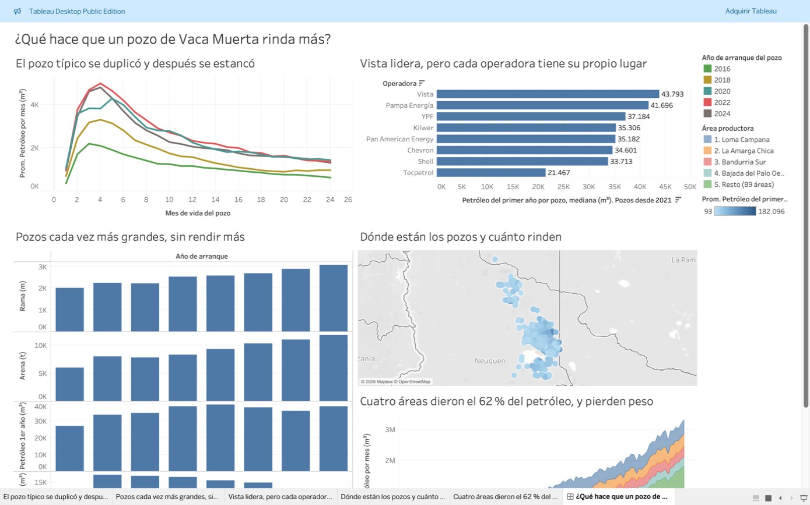

# Vaca Muerta en datos

Análisis en SQL de la formación Vaca Muerta, en Neuquén, con veintitrés fuentes abiertas, la mayoría de la Secretaría de Energía de Argentina. Cuarenta y dos preguntas, de 2006 a agosto de 2026, que arman una sola historia.

- **[Vaca Muerta explicado](https://ftornello.github.io/vaca-muerta-well-productivity/)**: la historia en cinco ideas, con esquemas, gráficos y un simulador. Es el mejor lugar para empezar.
- **[Tablero en Tableau Public](https://public.tableau.com/views/vaca_muerta_tablero/QuhacequeunpozodeVacaMuertarindams)**: curva del pozo, diseño, operadoras, mapa y áreas.
- **[Bitácora](BITACORA.md)**: cómo fui razonando cada decisión, incluidas las veces que tuve que corregir algo.

## La historia en cinco actos

**1. Aprendieron a hacer el pozo.** Entre 2016 y 2021 el petróleo del primer año de un pozo típico se duplicó, de 17.000 a 38.000 m³. El crecimiento venía de tres cosas a la vez: más pozos (52 %), ramas más largas (36 %) y más rendimiento por kilómetro (11 %). Las operadoras que llegaron después arrancaron con el doble de rendimiento que YPF en 2012. *(Preguntas 1, 2, 35 y 50)*

**2. En 2021 el pozo dejó de mejorar, y el núcleo se está apretando.** Desde entonces la rama se alargó 22 % y la arena subió 43 %, pero cada kilómetro rinde 22 % menos. Cuatro medidas independientes apuntan a la misma causa, pozos cada vez más pegados a otros que ya drenaron la roca: los que tienen un padre a menos de 300 m rinden 15 % menos y pierden la presión antes (66 % fluye solo al tercer año, contra 79 %); las áreas históricas bajan mientras las nuevas suben; y en esas áreas históricas cerca del 40 % de los pozos nuevos ya nace a menos de 500 m de un padre, contra 18 % en 2019. El lugar, el nivel de la roca y la arena explican el 39 % de las diferencias entre pozos; el resto queda sin explicar con datos públicos. *(5, 6, 7, 41, 47 y 52)*

**3. Ahora crece solo porque se perfora más.** Entre 2021 y 2024, tener más pozos explica más del 100 % del crecimiento: el rendimiento restó la mitad. Los pozos que existen pierden 37 % por año, así que más de la mitad de lo que se perfora solo repone. Sin pozos nuevos la producción caería 40 % en un año. El pozo cuesta 50 % más que en 2021, sobre todo porque el metro perforado se encareció, y el precio para recuperarlo en dos años subió de 27 a 44 dólares. *(8, 12, 22, 24, 36, 37, 50 y 54)*

**4. Ese petróleo no cabe en el país.** Vaca Muerta es el 63 % del petróleo argentino, pero las refinerías procesan lo mismo que hace quince años: tomaron menos de un tercio de lo que se sumó desde 2017. El resto se exporta, 53 % del total, con el oleoducto como cuello de botella en 2022 y 2023. El saldo energético del país pasó de −6.900 millones de dólares en 2013 a +7.800 en 2025, y el precio local, que antes iba por su cuenta, hoy sigue al internacional. *(10, 14, 26, 27, 31 y 33)*

**5. El gas quedó atrapado.** Tiene la roca y las reservas, pero no el mercado. Vaca Muerta ya es el 53 % del gas del país y el total casi no creció: reemplazó al convencional. El precio está fijo en 2,9 dólares pase lo que pase afuera, los pozos se cierran cada primavera (20 % parados contra 10 % en invierno), el gas que viene con el petróleo crece más rápido que el petróleo, y las propias empresas pronostican +2 % para el gas contra +24 % para el petróleo. *(9, 11, 13, 27, 32, 40, 42, 48 y 49)*

**Lo que queda abierto.** El ritmo de perforación de 2026 es exactamente el que pide un millón de barriles por día en 2030: unos 555 pozos por año. Las empresas declaran menos (754 mil en 2029) y la realidad viene yendo por encima de lo que declaran. Depende de sostener ese ritmo con un pozo que ya no mejora, y las reservas comprobadas fuera de los pozos existentes alcanzan para menos de tres años de perforación. *(28, 36 y 44)*

### Qué tan firme es cada cosa

| Lo que digo | Cómo está respaldado |
|---|---|
| El pozo típico se estancó en 2021 | Medianas de 1.688 pozos; no cambia más de 2 % sacando los datos raros (39). Coincide con FDC y Enverus |
| Un pozo son 6 km: 3 hacia abajo y 3 de rama | Dos planillas independientes dan lo mismo (30) |
| La base cae 37 % por año | Dos métodos distintos (24 y 36); la proyección erró menos de 10 % contra cinco años reales |
| Se exporta lo que no se puede refinar | Lo que sobra de refinar (250 mil barriles por día) coincide con lo embarcado (233 mil) (27) |
| El saldo energético de 2025 | Mi serie da 7.829 millones; el INDEC informó 7.815 (26) |
| El pozo cuesta unos 14 millones | Coincide con FDC para 2019 y 2020 y con Aleph Energy para 2025 (12 y 37) |
| El núcleo se está apretando | Cuatro señales independientes y literatura técnica sobre el efecto padre-hijo. Es la conclusión más interpretativa: los datos muestran el resultado, no el mecanismo |
| El gas no tiene mercado | Volumen, precio, estado de los pozos y pronósticos de las empresas dicen lo mismo |

Los datos de diseño de pozo son firmes de 2016 a 2024 (pregunta 51). Cada sección de la [bitácora](BITACORA.md) dice qué no se puede afirmar.

## Tablero interactivo

[](https://public.tableau.com/views/vaca_muerta_tablero/QuhacequeunpozodeVacaMuertarindams)

## Las preguntas

La numeración tiene saltos porque este repositorio publica una parte de un trabajo más largo; conservé los números originales para que coincidan con la bitácora.

### Punto de partida

| # | Pregunta | Respuesta en una línea | Consulta | Bitácora |
|---|---|---|---|---|
| 1 | ¿Los pozos nuevos rinden más? | Sí hasta 2021 (de 17.300 a 38.200 m³ en el primer año); después no | [p1](sql/analisis/p1_curva_tipica.sql) | 9 |
| 2 | ¿Hacerlo más grande lo hace rendir más? | Cada vez menos: cada km de rama rinde 22 % menos que en 2021 | [p2](sql/analisis/p2_diseno.sql) | 10 |
| 3 | ¿Hay operadoras mejores? | Vista lidera, pero cada área tiene una sola operadora y no se puede separar del lugar | [p3](sql/analisis/p3_operadoras.sql) | 11 |
| 4 | ¿De dónde sale el petróleo? | 4 áreas de 93 dieron el 62 % histórico; hoy 49 % | [p4](sql/analisis/p4_concentracion.sql) | 12 |
| 5 | ¿Qué pesa más? | Lugar 18 %, diseño 20 %; juntos 35 % | [p5](sql/analisis/p5_que_pesa_mas.sql) | 13 |

### Acto 1. Aprendieron a hacer el pozo

| # | Pregunta | Respuesta en una línea | Consulta | Bitácora |
|---|---|---|---|---|
| 22 | ¿Cuánto produce un pozo en toda su vida? | Unas 4,2 veces el primer año: cerca de un millón de barriles. Perforarlo cuesta 13 dólares por barril, contra 8 en 2021 | [p22](sql/analisis/p22_vida_del_pozo.sql) | 39 |
| 35 | ¿Las operadoras que llegaron tarde aprendieron de cero? | No: arrancaron con el doble de rendimiento que YPF en 2012. Pero solo Vista empezó al nivel de la industria; el resto, 25 % a 50 % abajo | [p35](sql/analisis/p35_curva_de_aprendizaje.sql) | 56 |
| 38 | ¿Cuáles son los mejores pozos? | Doce de los veinte pozos de Bajo del Choique superan el doble de un pozo típico. Los excepcionales pasaron de ninguno en 2018 al 6 % en 2025 | [p38](sql/analisis/p38_los_mejores_pozos.sql) | 59 |

### Acto 2. El pozo dejó de mejorar

| # | Pregunta | Respuesta en una línea | Consulta | Bitácora |
|---|---|---|---|---|
| 6 | ¿Por qué cae el rendimiento por km? | La caída está dentro de las áreas históricas, no en la expansión a zonas nuevas | [p6](sql/analisis/p6_por_que_cae_el_rendimiento.sql) | 15 |
| 7 | ¿Importa el subsuelo? | La unidad inferior rinde 10 a 47 % más; un pozo padre a menos de 300 m resta 15 % | [p7](sql/analisis/p7_subsuelo.sql) | 17 |
| 41 | ¿Se está saliendo de sus cuatro áreas, y rinde igual afuera? | Sí: en 2026 solo el 44 % de los pozos nuevos está en las históricas (93 % en 2014). Y la brecha de rendimiento se cerró de −35 % a −9 % | [p41](sql/analisis/p41_fuera_de_las_historicas.sql) | 62 |
| 47 | ¿Cuándo deja un pozo de fluir solo? | A los tres años la mitad ya necesita bomba o gas; después de los cuatro, cuatro de cada cinco. Entre los de YPF, los recientes la necesitan algo antes (ver 52) | [p47](sql/analisis/p47_cuando_dejan_de_fluir_solos.sql) | 68 |
| 52 | ¿Los pozos pegados a un padre pierden la presión antes? | Sí: al tercer año fluye solo el 66 % de los que tienen un padre a menos de 300 m, contra 79 % de los que no. Se repite en las tres áreas | [p52](sql/analisis/p52_padre_cerca_y_presion.sql) | 73 |
| 55 | Los pozos del nivel profundo arrancan mejor. ¿También caen distinto? | No: la forma de la curva es la misma en todos los niveles. La ventaja se mantiene entera: en Loma Campana, 67 % más petróleo por km a los cuatro años | [p55](sql/analisis/p55_nivel_y_curva_de_vida.sql) | 76 |

### Acto 3. Crece porque se perfora más

| # | Pregunta | Respuesta en una línea | Consulta | Bitácora |
|---|---|---|---|---|
| 8 | ¿Cuánto se aceleró la fábrica? | Fractura al doble de velocidad, pero el ciclo completo sigue en 213 días | [p8](sql/analisis/p8_fabrica_de_pozos.sql) | 18 |
| 12 | ¿Cuánto cuesta un pozo? | Unos 14 millones de dólares en las áreas grandes, contra 9 en 2021 | [p12](sql/analisis/p12_costos.sql) | 23 |
| 24 | ¿Cuánto hay que perforar solo para no caer? | Los pozos que ya existen pierden 37 % por año. En 2025 hicieron falta unos 250 pozos de los 470 nuevos solo para reponer esa caída | [p24](sql/analisis/p24_cinta_de_correr.sql) | 44 |
| 25 | ¿Se perfora más cuando el petróleo vale más? | Casi no: sacando la tendencia, la relación entre precio y actividad es débil (0,2). En 2025 el precio bajó 11 % y las etapas subieron 45 % | [p25](sql/analisis/p25_precio_y_actividad.sql) | 45 |
| 36 | ¿Qué pasa si se deja de perforar? | La producción cae 40 % en un año y 63 % en poco más de tres. Mantener el nivel pide unos 336 pozos por año; el millón de barriles, 555 | [p36](sql/analisis/p36_si_se_deja_de_perforar.sql) | 57 |
| 37 | ¿A qué precio se paga un pozo? | A 60 dólares, en 15 meses. Para recuperarlo en dos años hacen falta 44 dólares; con el pozo de 2021 alcanzaban 27. Sin gastos de operación ni impuestos | [p37](sql/analisis/p37_a_que_precio_se_paga.sql) | 58 |
| 40 | ¿A quién le pesa más la cinta de correr? | En 2025 Vista y Shell perforaron y terminaron produciendo menos. YPF usó el 54 % de sus pozos nuevos en reponer. En gas, los pozos viejos cayeron 47 % en 2026 | [p40](sql/analisis/p40_cinta_por_operadora_y_gas.sql) | 61 |
| 50 | ¿De dónde salió el crecimiento? | Hasta 2021, de tres cosas a la vez: más pozos (52 %), ramas más largas (36 %) y más rendimiento (11 %). Desde 2021, solo de perforar más: el rendimiento restó la mitad | [p50](sql/analisis/p50_de_donde_salio_el_crecimiento.sql) | 71 |
| 54 | ¿El pozo es más caro porque es más largo o porque perforar se encareció? | Sobre todo lo segundo: entre 2021 y 2024 el dólar por metro subió 50 % y explica tres cuartos del encarecimiento | [p54](sql/analisis/p54_costo_por_metro.sql) | 75 |

### Acto 4. No cabe en el país

| # | Pregunta | Respuesta en una línea | Consulta | Bitácora |
|---|---|---|---|---|
| 10 | ¿Alcanza el oleoducto? | Estuvo lleno todo 2024; con el caño nuevo ya llegó otra vez al límite | [p10](sql/analisis/p10_evacuacion.sql) | 21 |
| 14 | ¿A dónde va el petróleo? | Se exporta el 53 %; Estados Unidos baja de 67 % a 35 % y aparece Asia | [p14](sql/analisis/p14_exportaciones.sql) | 25 |
| 26 | ¿Qué le cambió al comercio exterior del país? | El saldo energético pasó de −6.900 millones de dólares en 2013 a +7.800 en 2025. La mitad de la energía exportada ya es crudo neuquino | [p26](sql/analisis/p26_balanza_energetica.sql) | 46 |
| 27 | ¿Cuánto pesa en el petróleo y el gas del país? | Es el 63 % del petróleo y el 53 % del gas. Las refinerías procesan lo mismo que hace quince años, así que lo que agrega se exporta. En gas el total casi no creció: reemplazó al convencional | [p27](sql/analisis/p27_peso_en_el_pais.sql) | 47 |
| 31 | ¿Qué petróleo procesan las refinerías? | El crudo de la cuenca Neuquina reemplazó al importado y a las otras cuencas, pero las refinerías tomaron menos de un tercio de lo que Vaca Muerta sumó desde 2017 | [p31](sql/analisis/p31_que_crudo_se_refina.sql) | 51 |
| 33 | ¿A cuánto se vende comparado con el precio internacional? | Hasta 2014 se cobraba entre 56 % y 81 % del Brent y casi no lo seguía; desde 2021 se mueven juntos y en 2025 se cobró el 90 % | [p33](sql/analisis/p33_brent.sql) | 54 |

### Acto 5. El gas

| # | Pregunta | Respuesta en una línea | Consulta | Bitácora |
|---|---|---|---|---|
| 9 | ¿El gas sigue a las estaciones? | Sí, y cada año más: cae 36 % del invierno a la primavera | [p9](sql/analisis/p9_gas.sql) | 19 |
| 11 | ¿El precio del gas acompaña? | Cae 20 a 40 % cada primavera, igual que antes; lo que creció es el gas sin vender | [p11](sql/analisis/p11_precio_del_gas.sql) | 22 |
| 13 | ¿Y los pozos de gas? | El lugar explica 42 %; el rendimiento por km casi no cayó | [p13](sql/analisis/p13_gas_a_fondo.sql) | 24 |
| 32 | ¿Qué esperan las empresas del gas? | Que no crezca: de 2026 a 2029 pronostican +2 % para el gas de Neuquén contra +24 % para el petróleo | [p32](sql/analisis/p32_pronostico_de_gas.sql) | 52 |
| 42 | ¿El gas es caro o barato? | Ni una cosa ni la otra: está fijo. Cobró 2,9 dólares con el Henry Hub en 6,4 (2022) y también con el Henry Hub en 2,2 (2024) | [p42](sql/analisis/p42_gas_contra_henry_hub.sql) | 63 |
| 48 | ¿Cuántos pozos están parados? | El 85 % produce. Los de gas parados pasan de 10 % en julio a 20 % en primavera. Los de petróleo produjeron menos días en 2022, con el oleoducto lleno | [p48](sql/analisis/p48_pozos_parados.sql) | 69 |
| 49 | ¿Los pozos de petróleo traen cada vez más gas? | Sí: cada pozo trae más gas con la edad, y desde 2023 cada barril viene con 22 % más gas | [p49](sql/analisis/p49_gas_que_viene_con_el_petroleo.sql) | 70 |

### Lo que queda abierto

| # | Pregunta | Respuesta en una línea | Consulta | Bitácora |
|---|---|---|---|---|
| 15 | ¿Cuánto queda? | Las reservas se multiplicaron por 21, pero alcanzan para 14 años contra 21 en 2019 | [p15](sql/analisis/p15_reservas.sql) | 26 |
| 28 | ¿Las empresas cumplen lo que pronostican? | Desde 2021 aciertan dentro de un 15 %; antes se quedaban muy cortas. Para 2029 declaran 754 mil barriles por día, y la producción ya va por encima de su pronóstico | [p28](sql/analisis/p28_pronosticos.sql) | 48 |
| 44 | ¿Cuánto les queda por dar a los pozos que ya existen? | Unos 204 millones de m³, la mitad de las reservas comprobadas. La otra mitad son unos 1.300 pozos por perforar: menos de tres años al ritmo actual | [p44](sql/analisis/p44_lo_que_queda_en_los_pozos.sql) | 65 |

### Qué tan confiables son los datos

| # | Pregunta | Respuesta en una línea | Consulta | Bitácora |
|---|---|---|---|---|
| 30 | ¿Cuánto se perfora en Neuquén? | El 85 % de los metros del país, contra 18 % en 2010. Da 6 km por pozo: 3 hacia abajo y 3 de rama, lo mismo que sale de las otras tablas | [p30](sql/analisis/p30_metros_perforados.sql) | 50 |
| 39 | ¿Hay pozos cuya curva no tiene sentido, y cambian los resultados? | El 4 % tiene su máximo después del noveno mes, y uno tiene una producción que no es creíble. Sacándolos, el pozo típico de cada año cambia menos de 2 % | [p39](sql/analisis/p39_auditoria_de_curvas.sql) | 60 |
| 51 | ¿Qué tan completos están los datos? | Para medir un pozo hacen falta doce meses de producción: el diseño es firme de 2016 a 2024. Las trayectorias cubren 90 % hasta 2023 y 22 % en 2025 | [p51](sql/analisis/p51_que_tan_completos_estan_los_datos.sql) | 72 |

## Contraste con otras fuentes

| Dato propio | Fuente externa |
|---|---|
| Producción del primer año: 17.323 m³ (2016) y 27.125 (2018) | FDC: 17.000 y 27.800 |
| Costo por pozo: 9,6 y 9,1 millones de USD (2019 y 2020) | FDC: 10,5 y 9,5 |
| Producción de un pozo en toda su vida: 115 y 146 mil m³ (2018 y 2020) | FDC: 118 y 158 |
| Caída por km desde 2021: unos 6 % anual | Enverus: 7 a 12 % anual |
| Caída estacional del gas en 2025: 28 millones de m³ por día | Prensa: 29 retirados por cierres |
| Oleoducto en agosto de 2026: 542 mil barriles por día | Prensa: límite del sistema, 530 mil |
| Reservas: 14 años de petróleo y 17 de gas | IAE: horizontes de 15 y 13 años |

El detalle y los enlaces están en las secciones 15, 20 y 77 de la [bitácora](BITACORA.md).

## Límites

- **Son asociaciones, no causas.**
- **La producción de un pozo más allá de los 10 años es una proyección,** con tres escenarios.
- **Solo se comparan pozos con 12 meses cumplidos.** 2026 no entra en las preguntas de rendimiento.
- **Las trayectorias cubren 44 % de los pozos de 2024 y 25 % de los de 2025.**
- **Las fracturas tienen unos tres meses de demora** en la fuente.
- **Costos y reservas son declaraciones de las empresas, sin auditar.** Los costos solo son confiables en las áreas más grandes.
- **Oleoductos y embarques son de toda la cuenca Neuquina,** no solo de Vaca Muerta.

## Cómo está hecho

PostgreSQL en dos capas, con un paso en Python para el ajuste estadístico: `raw` guarda cada archivo tal cual se publica y `vm` es el modelo limpio, que se reconstruye entero con un script. Ocho controles verifican que no se pierde nada respecto de la fuente. Los valores imposibles no se borran: quedan marcados con su motivo.

| Archivo | Qué hace |
|---|---|
| [sql/01_raw_tablas.sql](sql/01_raw_tablas.sql), [02_raw_carga.sql](sql/02_raw_carga.sql) | Crea la capa `raw` y carga producción, fractura y padrón |
| [sql/03_capa_limpia.sql](sql/03_capa_limpia.sql) | Construye el modelo limpio y aplica las reglas de limpieza |
| [sql/04_controles.sql](sql/04_controles.sql) | Compara la fuente contra el modelo |
| [sql/05_vistas_analisis.sql](sql/05_vistas_analisis.sql) | Vistas de apoyo para petróleo y para gas |
| [sql/07_trayectorias.sql](sql/07_trayectorias.sql) | Arma la rama de cada pozo punto por punto y mide distancias entre vecinos |
| [sql/08_datos_complementarios.sql](sql/08_datos_complementarios.sql) | Carga precios del gas, oleoductos, inversiones, exportaciones y reservas |
| [sql/analisis/](sql/analisis) | Una consulta por pregunta |
| [sql/06_exportar_dashboard.sql](sql/06_exportar_dashboard.sql) | Exporta las tablas que usa el tablero |
| [sql/09_regalias_y_empleo.sql](sql/09_regalias_y_empleo.sql) | Carga regalías, tipo de cambio, empleo registrado en Neuquén y precios en surtidor |
| [scripts/descargar_precios_surtidor.py](scripts/descargar_precios_surtidor.py) | Pide a la API del portal los precios de combustibles ya resumidos |
| [sql/11_curva_tipo.sql](sql/11_curva_tipo.sql), [12_declinacion.sql](sql/12_declinacion.sql) | Arma la curva tipo de un pozo y carga su extensión a 25 años |
| [scripts/ajustar_declinacion.py](scripts/ajustar_declinacion.py) | Ajusta la curva de declinación (Arps) y calcula tres escenarios |
| [scripts/grafico_vida_del_pozo.py](scripts/grafico_vida_del_pozo.py) | Dibuja la producción acumulada de un pozo a 25 años |
| [sql/10_controles_complementarios.sql](sql/10_controles_complementarios.sql) | Controla los enlaces y la cobertura de las tablas que se suman al núcleo |
| [sql/13](sql/13_comercio_exterior.sql) a [17](sql/17_referencias_externas.sql) | Cargan el comercio exterior, la producción y refinación del país, los pronósticos de las empresas y los precios de referencia de afuera |
| [data/FUENTES.csv](data/FUENTES.csv) | Qué archivo se bajó, de dónde, cuándo y con qué huella |
| [scripts/preparar_reservas.py](scripts/preparar_reservas.py), [preparar_regalias.py](scripts/preparar_regalias.py) | Pasan a CSV las planillas de reservas y de regalías |

Para entender los datos: [diccionario](DICCIONARIO.md). Para entender las decisiones: [bitácora](BITACORA.md).

## Cómo reproducirlo

Requiere PostgreSQL 17 y Python 3 (`pip install -r requirements.txt`).

```bash
./scripts/descargar_datos.sh
createdb vaca_muerta
./scripts/reconstruir.sh
psql -d vaca_muerta -f sql/analisis/p1_curva_tipica.sql
```

Los números corresponden a las descargas del 9 y 10 de octubre de 2026. La fuente se actualiza todos los meses.

## Fuentes

Secretaría de Energía de la Nación, [datos.energia.gob.ar](http://datos.energia.gob.ar): producción por pozo (Capítulo IV), fractura (Adjunto IV), trayectorias de pozo, precios de gas natural, transporte de hidrocarburos (planillas 20 y 21), inversiones upstream (Res. 2057), reservas y regalías. Empleo y salarios: CEP XXI, Secretaría de Producción.

Francisco Tornello, 2026. Trabajé con Claude Code como asistente.

## Licencia

El código se publica bajo licencia [MIT](LICENSE). Los datos son públicos y pertenecen a sus fuentes.
