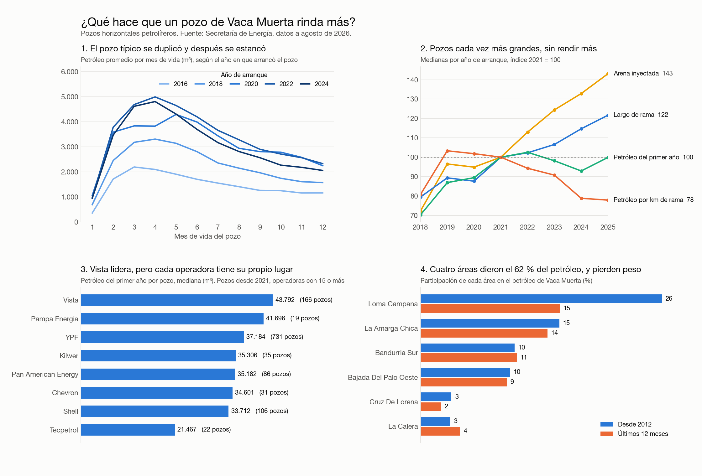

# ¿Qué hace que un pozo de Vaca Muerta rinda más?

Análisis en SQL de los 3.417 pozos de la formación Vaca Muerta con datos abiertos de la Secretaría de Energía de Argentina: producción mes a mes de cada pozo, diseño de cada fractura y recorrido de cada rama bajo tierra, de 2006 a agosto de 2026.

## La respuesta corta

**Ni el diseño, ni la operadora, ni el lugar alcanzan por sí solos.** El lugar y el diseño explican cerca de un quinto de las diferencias cada uno, la operadora no se puede separar del lugar, y casi dos tercios de las diferencias entre pozos no los explica nada de lo que se publica.



## Lo que encontré

1. **El pozo típico más que duplicó su rendimiento entre 2016 y 2021, y después se estancó.** El petróleo del primer año pasó de 17.300 a 38.200 m³ (mediana) y desde entonces se mueve entre 36.000 y 40.000.

2. **Desde 2021 los pozos son cada vez más grandes sin rendir más.** La rama horizontal se alargó 22 % y la arena inyectada subió 43 %, pero la producción del primer año quedó igual. Cada kilómetro de rama rinde 22 % menos que en 2021.

3. **El ranking de operadoras es también un ranking de lugares.** Vista lidera en petróleo por pozo (43.800 m³ en el primer año), pero en Vaca Muerta cada área la opera una sola empresa, así que no se puede saber cuánto es mérito de la operadora y cuánto de la roca. YPF, la misma empresa, saca 42.500 m³ por pozo en Loma Campana y 28.900 en Bajo del Toro Norte.

4. **Cuatro áreas de 93 produjeron el 62 % del petróleo histórico**, pero la concentración baja: en los últimos 12 meses esas cuatro suman 49 %.

| Año de arranque | Pozos | Rama (m) | Arena (t) | Petróleo 1er año (m³) | Por km de rama (m³) |
|---|---|---|---|---|---|
| 2016 | 66 | 1.411 | 4.252 | 17.455 | 13.306 |
| 2019 | 105 | 2.250 | 7.931 | 33.511 | 16.846 |
| 2021 | 162 | 2.518 | 8.218 | 38.573 | 16.307 |
| 2023 | 216 | 2.684 | 10.226 | 37.861 | 14.797 |
| 2025 | 291 | 3.065 | 11.761 | 38.533 | 12.695 |

*Medianas de pozos horizontales petrolíferos con datos de fractura completos.*

## Por qué pasa

Busqué qué dicen otras fuentes, puse a prueba cada explicación con los datos y sumé el recorrido bajo tierra de cada pozo:

- **Los números coinciden con los de la industria.** La consultora FDC estimó la producción a 365 días del pozo tipo en 17.000 m³ para 2016 y 27.800 para 2018; mis medianas dan 17.323 y 27.125.
- **"Se perfora en zonas menos buenas" explica solo una parte.** La caída por kilómetro ocurre sobre todo dentro de las cuatro áreas históricas (de 17.211 a 13.212 m³ por km entre 2021 y 2025); en el resto casi no cambió.
- **No es un efecto de mirar solo 12 meses.** A 24 meses la caída es la misma.
- **La interferencia entre pozos vecinos existe, pero no alcanza.** Midiendo la distancia real entre ramas, un pozo con un "padre" del mismo nivel a menos de 300 metros rinde cerca de 15 % menos que uno que lo tiene a más de 500.
- **El nivel de la roca importa.** En la misma área, los pozos que navegan en la unidad inferior de Vaca Muerta rinden entre 10 % y 47 % más por kilómetro que los de la unidad media. Sumarlo lleva lo explicado de 35 % a 39 %.

El detalle y las fuentes están en las secciones 15 y 17 de la [bitácora](BITACORA.md).

## Límites

- **Son asociaciones, no causas.** Que los pozos más largos rindan menos por kilómetro puede deberse al diseño, a que los pozos nuevos estén en roca menos buena, o a que las empresas regulen el caudal. Estos datos no lo separan.
- **El análisis de rendimiento cubre petróleo.** Los pozos de gas (una cuarta parte de los horizontales) quedaron afuera de las preguntas 1 a 3.
- **Solo se comparan pozos con 12 meses cumplidos.** 2025 incluye los que arrancaron hasta septiembre; 2026 no entra.
- **La agrupación de empresas es manual:** uní razones sociales de la misma marca, sin seguir compras entre empresas distintas.

## Cómo está hecho

Cuatro tablas de la fuente (producción, fractura, padrón de pozos y trayectorias) cargadas en PostgreSQL en dos capas:

- **`raw`**: los CSV tal cual se publican.
- **`vm`**: un modelo limpio de seis tablas (`pozo`, `produccion_mensual`, `fractura`, `area`, `empresa`, `operadora`), con ocho controles que verifican que no se perdió nada respecto de la fuente.

Los valores imposibles no se borran: quedan marcados con su motivo, y cada consulta decide qué excluir.

| Archivo | Qué hace |
|---|---|
| [sql/01_raw_tablas.sql](sql/01_raw_tablas.sql), [02_raw_carga.sql](sql/02_raw_carga.sql) | Crea la capa `raw` y carga los CSV |
| [sql/03_capa_limpia.sql](sql/03_capa_limpia.sql) | Construye el modelo limpio y aplica las reglas de limpieza |
| [sql/04_controles.sql](sql/04_controles.sql) | Compara la fuente contra el modelo |
| [sql/05_vistas_analisis.sql](sql/05_vistas_analisis.sql) | Vistas de apoyo: edad del pozo y producción del primer año |
| [sql/analisis/](sql/analisis) | Una consulta por pregunta, más las pruebas de cada explicación |
| [sql/06_exportar_dashboard.sql](sql/06_exportar_dashboard.sql) | Exporta las tablas que usa el tablero |
| [sql/07_trayectorias.sql](sql/07_trayectorias.sql) | Carga las trayectorias, arma la rama de cada pozo punto por punto y mide distancias entre vecinos |
| [scripts/boceto_resultados.py](scripts/boceto_resultados.py) | Genera la imagen de arriba |

Más detalle en el [diccionario de datos](DICCIONARIO.md) y en la [bitácora](BITACORA.md), donde está el razonamiento de cada decisión.

## Cómo reproducirlo

Requiere PostgreSQL 17 y Python 3.

```bash
./scripts/descargar_datos.sh
createdb vaca_muerta
psql -d vaca_muerta -f sql/01_raw_tablas.sql
psql -d vaca_muerta -f sql/02_raw_carga.sql
psql -d vaca_muerta -f sql/03_capa_limpia.sql
psql -d vaca_muerta -f sql/04_controles.sql
psql -d vaca_muerta -f sql/05_vistas_analisis.sql
psql -d vaca_muerta -f sql/07_trayectorias.sql
psql -d vaca_muerta -f sql/analisis/p1_curva_tipica.sql
```

La fuente se actualiza todos los meses, así que una descarga nueva va a dar números algo distintos. Los de este análisis corresponden a la descarga del 9 de octubre de 2026.

## Fuente

Secretaría de Energía de la Nación, [Producción de petróleo y gas por pozo (Capítulo IV)](http://datos.energia.gob.ar/dataset/produccion-de-petroleo-y-gas-por-pozo) [Datos de fractura de pozos (Adjunto IV)](http://datos.energia.gob.ar/dataset/datos-de-fractura-de-pozos-adjunto-iv) y [Trayectorias de Pozo Vaca Muerta](http://datos.energia.gob.ar/dataset/trayectoria-de-pozos). Unidades: petróleo y agua en m³, gas en miles de m³.

Francisco Tornello, 2026. Trabajé con Claude Code como asistente.
